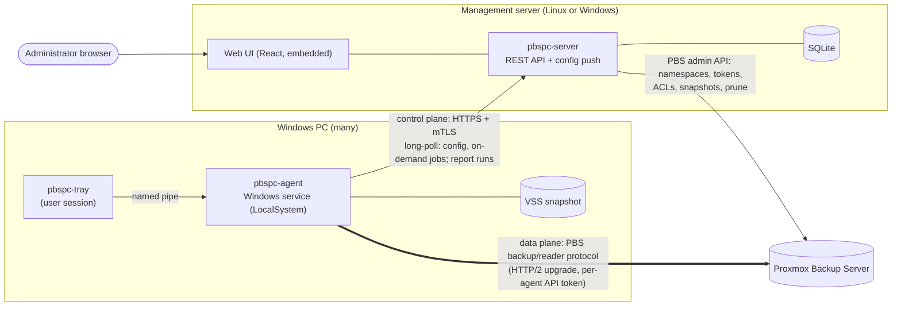
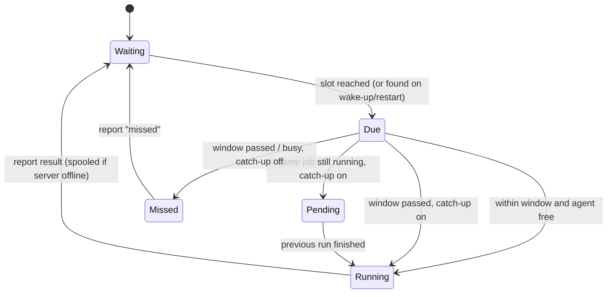
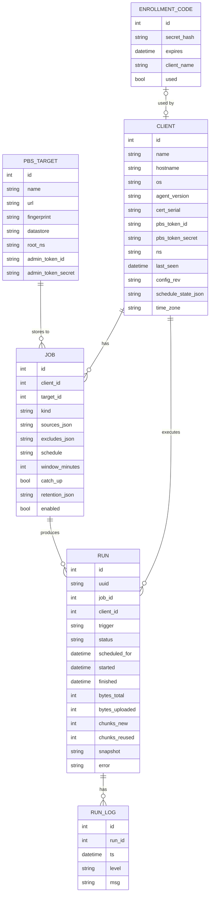

# PBS PC Client — Architecture

A centrally managed backup system for Windows PCs that stores backups **natively** on a
Proxmox Backup Server (PBS). There is no Linux proxy and no official `proxmox-backup-client`
in the data path: the Windows agent speaks the PBS backup protocol itself, so backups get the
same chunk-level deduplication, verification, sync and prune behaviour as any other PBS client.

## Goals

| Goal | How |
|------|-----|
| File-level backups of Windows PCs | VSS snapshot → pxar v1 archive → dynamic chunk index (`*.pxar.didx`) |
| Volume image backups | VSS snapshot of the volume device → fixed 4 MiB chunk index (`*.img.fidx`) |
| Central management | Management server with web UI: clients, jobs, schedules, history, restore |
| No inbound ports on PCs | Agents dial out to the management server (long-poll over mTLS) |
| The PC decides when to back up | The server only pushes configuration. Each agent runs its own scheduler on the PC's clock, catches up missed runs if the job allows it, and keeps backing up while the server is down |
| Ransomware resilience | Agents get a PBS token with **DatastoreBackup** only — they can add backups, never delete or prune them |
| Interoperability | Snapshots are standard PBS snapshots: visible in the PBS GUI, verifiable, syncable, restorable with `proxmox-backup-client` on Linux |

## System overview



**Control plane and data plane are separate.** Backup data never flows through the
management server: the agent uploads chunks straight to PBS. The management server only
orchestrates the work.

## Components

### 1. `pkg/pbs`: PBS protocol library (Go)

This is a clean-room Go implementation of the PBS client protocol, written against the
upstream sources (`proxmox-backup` and `pxar` git repositories).

| Piece | Details |
|-------|---------|
| Auth | `Authorization: PBSAPIToken <user>@<realm>!<token>:<secret>`; TLS certificate pinned by SHA-256 fingerprint (PBS uses self-signed certs) |
| Session upgrade | `GET /api2/json/backup?store=&ns=&backup-type=host&backup-id=&backup-time=` with `Connection: upgrade`, `Upgrade: proxmox-backup-protocol-v1` → `101`, then HTTP/2 (prior knowledge) on the same TLS stream. Restore uses `/api2/json/reader` + `proxmox-backup-reader-protocol-v1` |
| Data blob | `MAGIC(8) ‖ CRC32(4, IEEE, over payload) ‖ payload`. Payload is a zstd frame when compression helps, otherwise raw. Encrypted variants add `IV(16) ‖ TAG(16)` (AES-256-GCM) |
| Chunk digest | `SHA-256(plain data)`; with encryption, `SHA-256(plain ‖ id_key)` where `id_key = PBKDF2-HMAC-SHA256(enc_key, "_id_key", 10)` |
| Chunker | Port of the upstream buzhash chunker (64-byte window, 4 MiB average, min/4, max×4). Identical boundaries mean chunks dedupe against Linux clients too |
| Dynamic index | `POST dynamic_index {archive-name}` → wid; `POST dynamic_chunk?wid&digest&size&encoded-size` (body = blob); `PUT dynamic_index` JSON `{wid, digest-list, offset-list}` (offsets are chunk **start** offsets); `POST dynamic_close?wid&chunk-count&size&csum` where `csum = SHA-256(Σ end_offset_le64 ‖ digest)` |
| Fixed index | Same with `fixed_*`, plus `size` on create; 4 MiB chunks; `csum = SHA-256(Σ digest)` |
| Incremental | `GET previous?archive-name=` downloads the last index and registers its chunks server-side; known chunks are appended without re-uploading |
| Manifest | `index.json.blob`: `{backup-type, backup-id, backup-time, files:[{filename, crypt-mode, size, csum}], unprotected:{}, signature}` → `POST blob?file-name=&encoded-size=`, then `POST finish` |

### 2. `pkg/pxar`: pxar v1 encoder and decoder

File-level backups must be real pxar archives. That way the PBS GUI, `proxmox-backup-client
restore`, and `pxar` FUSE mounts all work.

* Items are `Header{htype u64, full_size u64}` + payload, all little-endian.
* Per entry: `ENTRY{mode, flags, uid, gid, mtime{secs i64, nanos u32, pad u32}}`, then
  optional `XATTR`, then `PAYLOAD` for files or `SYMLINK` for links.
* Each directory: `FILENAME` (NUL-terminated, byte-sorted) + child archive, repeated, then a
  `GOODBYE` table. The table holds `{siphash24(name), rel_offset, size}` items in
  binary-search-tree array order, followed by a tail marker item.
* Windows mapping:

| Windows | pxar |
|---------|------|
| Directory / file | `S_IFDIR 0755` / `S_IFREG 0644` (`0444` if READONLY) |
| HIDDEN / SYSTEM / ARCHIVE | `flags`: `WITH_FLAG_HIDDEN 0x2000`, `WITH_FLAG_SYSTEM 0x4000`, `WITH_FLAG_ARCHIVE 0x8000` |
| LastWriteTime | `mtime` (100 ns resolution → ns) |
| Symlink reparse point | `SYMLINK` |
| Junctions / mount points | skipped (prevents loops and double-backup) |
| Security descriptor (NTFS ACL) | xattr `user.pbspc.ntsd` (self-relative binary SD) *(phase 2)* |
| Alternate data streams | xattr `user.pbspc.ads.<name>` for small streams *(phase 2)* |
| UTF-16 names | UTF-8 |

### 3. `pbspc-agent`: Windows service

* Runs as `LocalSystem` (needed for VSS and for reading every file), installed with
  `pbspc-agent install`.
* **Enrollment.** An admin creates a one-time enrollment code in the UI. The code bundles the
  server URL, a secret, and the server CA fingerprint. The agent generates an ECDSA key and
  CSR, and the server returns a client certificate signed by its internal CA. Every later
  call uses mTLS.
* **Configuration.** The agent long-polls `POST /agent/v1/poll` and sends the revision of the
  configuration it has. When the server's revision differs, it pushes the full config: the PBS
  target (endpoint, fingerprint, datastore, namespace, scoped API token) and all enabled jobs
  with their schedules. The agent stores it in `jobs.json` (0600). Saving a job in the UI wakes
  the poll, so changes arrive within seconds when the PC is online. At startup the agent tries a
  quick sync (≤10 s) before its first schedule check, so changes made while the PC was off take
  effect immediately.
* **Scheduling (agent-side).** See [Client-side scheduling](#client-side-scheduling) below.
  "Run now" and restores are the only work the server dispatches.
* **Reporting.** The agent registers runs it started itself with `POST /agent/v1/runs`, which is
  idempotent on a run UUID. Progress and logs then go to `POST /agent/v1/runs/{id}/events`. If
  the server is unreachable, the backup still runs. The report is spooled to disk (`spool/`) and
  delivered when the server is back, with the original start and finish times.
* **File backup.** For each volume touched by the sources, the agent creates one VSS
  snapshot, then walks `\\?\GLOBALROOT\Device\HarddiskVolumeShadowCopyN\…`. Each source path
  is streamed into the pxar encoder, then the chunker, then the uploader. Each source becomes
  one archive, e.g. `c-users.pxar.didx`.
* **Image backup.** The agent snapshots a volume with VSS and reads the shadow device
  sequentially into `drive-c.img.fidx` (4 MiB fixed chunks; zero chunks dedupe for free).
  Phase 3 adds a partition table and EFI/MSR blob for bare-metal restore, plus WinPE restore
  media.
* **Restore.** The agent opens a reader session, downloads the index, fetches chunks on
  demand, decodes pxar, and writes files to the original or an alternate path. Overwrite
  policy is set per job.
* **Local IPC.** A named pipe `\\.\pipe\pbspc-agent` serves the tray app (status, "Back up
  now", recent runs). The pipe ACL allows only interactive users plus SYSTEM.

### 4. `pbspc-server`: management server

* A single Go binary with the React SPA embedded (`go:embed`). SQLite via the pure-Go
  `modernc.org/sqlite`, so there is no cgo.
* **Listeners.** `:8443` serves the admin UI and API (session cookie + CSRF). `:8444` is the
  agent API (mTLS, client certs from the internal CA). Enrollment runs on `:8444` with server
  auth only.
* **PBS integration.** The server is configured once with a PBS **admin** token. On
  enrollment it:
  1. creates namespace `<root-ns>/<client-name>` on the datastore,
  2. creates API token `pbspc@pbs!<client-name>`,
  3. grants `DatastoreBackup` on `/datastore/<store>/<ns>` to that token.

  The agent only ever receives the scoped token.
* **No scheduler.** The server does not start backups. It validates schedules, pushes them,
  and shows what the agents report: next run, pending catch-up, config sync state, and the PC's
  time zone.
* **Retention.** After each successful run, the server calls PBS `prune` for the backup group
  with the job's keep-last/hourly/daily/weekly/monthly/yearly policy, using the admin token.
  Garbage collection is left to PBS's own schedule.
* **Notifications.** SMTP and generic webhooks (JSON). Triggers: run failed, run succeeded
  (optional), client offline > N days, last successful backup older than N days.

### 5. `pbspc-tray`: user tray app *(phase 2)*

A small systray process started at login. It shows last backup time and status, offers
"Back up now" and "Restore files…" (opens the web UI deep link or a local picker), and can
pause backups while the user is on battery or a metered network.

## Client-side scheduling

The agent owns the schedule. Every 20 s, after waking from sleep, and right after a config
update or finished run, it checks each job's cron expression against the PC's local clock.
For each job it remembers the last slot it handled (`schedule.json`), so restarts never re-run
a slot.

| Situation at a scheduled slot | `catch_up = on` (default) | `catch_up = off` |
|---|---|---|
| Agent free, within the job's **start window** (default 60 min) | start, trigger `schedule` | start, trigger `schedule` |
| PC was off/asleep or the agent wasn't running, window passed | start immediately, trigger `catch-up` | record a `missed` run |
| Same job still running from the previous slot | start right after it finishes (`catch-up`) | record a `missed` run |
| Waited in the queue behind another job past the window | run as `catch-up` | record a `missed` run |

* Several missed slots, e.g. after three days off, are coalesced into **one** catch-up run.
* New jobs and changed schedules start counting from "now". They never catch up on slots from
  before the change.
* Schedules use the PC's local time zone, which is reported to the server and shown in the UI.
* `missed` runs appear in the history and trigger failure notifications, with warning severity.



## Data model (management server)



Secrets (`admin_token_secret`, `pbs_token_secret`, encryption keys) are encrypted at rest
with a server master key (`PBSPC_MASTER_KEY`, or a key file with 0600 permissions).

## Backup flow


## Security model

* **Agent ↔ server:** mTLS using the internal CA. Enrollment codes are single-use and expire
  (24 h by default). Certificates can be revoked per client from the UI, which deletes the
  client and its PBS token.
* **Agent ↔ PBS:** the PBS certificate fingerprint is pinned. The scoped token has
  `DatastoreBackup` only, so a compromised PC cannot read other PCs' backups or delete its
  own history.
* **Client-side encryption (phase 2):** a per-client AES-256-GCM key, generated by the server,
  stored encrypted at rest, and optionally escrowed with an RSA master public key (same idea
  as `proxmox-backup-client key create --master-pubkey`).
* **Admin UI:** local admin accounts (argon2id), with optional OIDC in phase 3.

## Repository layout

```
cmd/pbspc-server/       management server entrypoint
cmd/pbspc-agent/        Windows agent entrypoint (service + CLI: enroll, backup, restore)
pkg/pbs/                PBS protocol: blob, chunker, backup & reader sessions, admin API
pkg/pxar/               pxar v1 encoder/decoder
internal/agent/         job runner, VSS, file walker, image reader, server client
internal/server/        HTTP API, store (SQLite), config push, PBS provisioning, notify
internal/schedule/      cron parsing and "is a slot due?" logic shared by agent and server
internal/api/           shared JSON types between agent and server
web/                    React + Vite admin UI (built into internal/server/webdist)
docs/                   this document
```

## Roadmap

| Phase | Scope |
|-------|-------|
| **1 — MVP** (implemented; verified against PBS 4.2 except Windows-only paths) | PBS protocol library, pxar encoder, buzhash chunker, file backup with VSS, volume image backup, enrollment + mTLS, job scheduling, run history and logs, retention via prune, webhook/SMTP notifications, restore of pxar archives to a folder, React UI |
| 2 | **`catalog.pcat1.didx` first** (the PBS GUI file browser refuses non-split pxar archives without it), client-side encryption + key escrow, NTFS ACLs and ADS in xattrs, tray app, per-file restore browser in the UI, bandwidth limits, metered-network/battery awareness |
| 3 | Bare-metal restore (WinPE media, GPT + EFI handling), changed-block tracking for images, OIDC login, multi-PBS targets, sync-job awareness |

## Risks and mitigations

| Risk | Mitigation |
|------|-----------|
| PBS protocol changes | The protocol is versioned (`-v1`) and stable since PBS 1.0. Integration tests run against a real PBS in CI |
| pxar encoding bugs make backups unrestorable | Round-trip tests with our decoder, plus validation with the official `pxar` crate / `proxmox-backup-client` in the E2E suite |
| VSS failures (writers in bad state, no space) | Fall back to a crash-consistent backup *only if the job allows it*, and log writer status |
| Long paths / odd names | `\\?\` prefixed paths throughout; names that are invalid in pxar (`/`) are escaped and logged |
| Locked files without VSS | VSS is the default; without it, files are skipped and warned about, never silently dropped |
