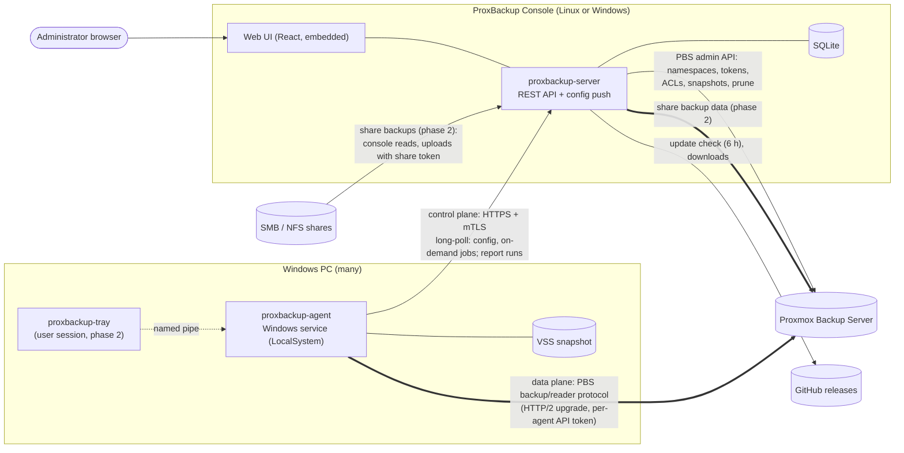
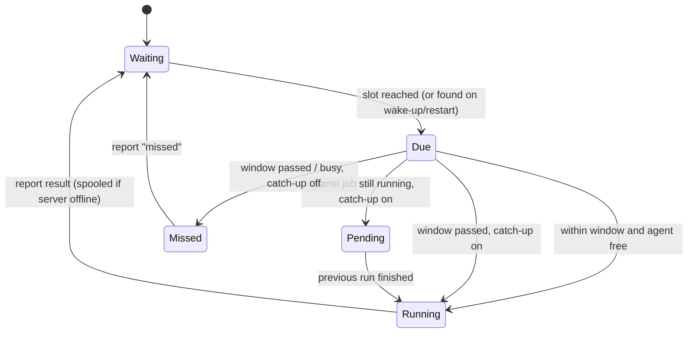
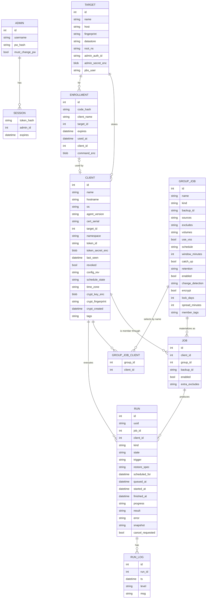
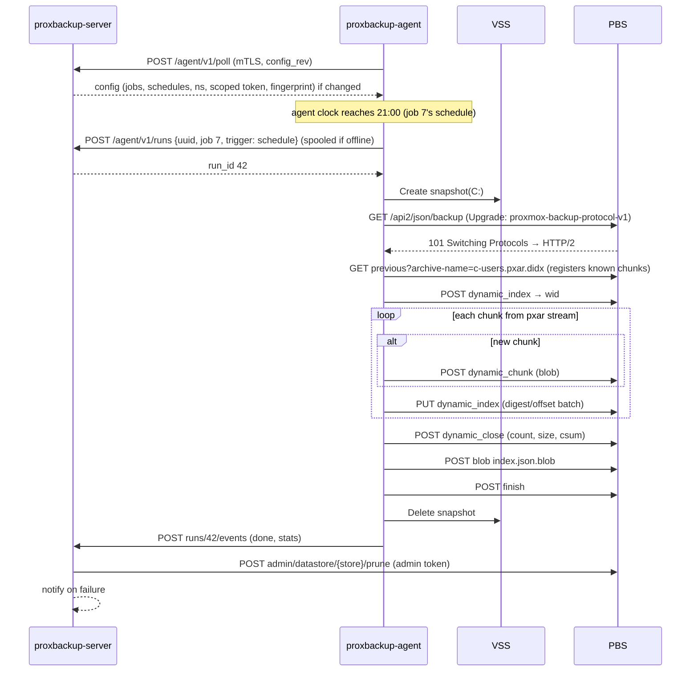
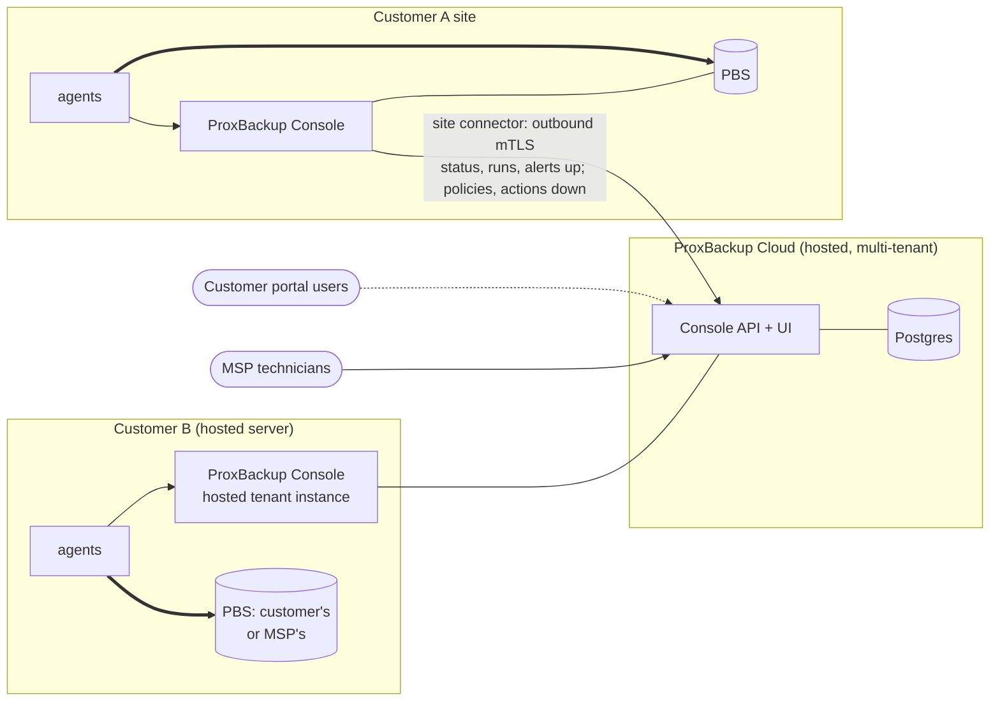
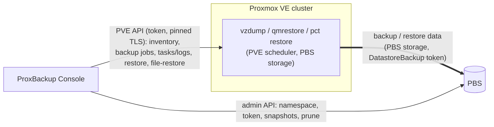

# ProxBackup Solution — Architecture

A centrally managed backup system for Windows PCs that stores backups **natively** on a
Proxmox Backup Server (PBS). There is no Linux proxy and no official `proxmox-backup-client`
in the data path: the Windows agent speaks the PBS backup protocol itself, so backups get the
same chunk-level deduplication, verification, sync and prune behaviour as any other PBS client.
Roadmap phase 7 brings Proxmox VE guest and host backups into the same console, so PCs,
VMs/containers and the PVE nodes themselves are managed and restored in one place.

## Goals

| Goal | How |
|------|-----|
| File-level backups of Windows PCs | VSS snapshot → pxar archive → dynamic chunk index (`*.mpxar.didx` + `*.ppxar.didx`, pxar v2 split archives, so unchanged files aren't re-read; `*.pxar.didx` for PBS before 3.3) |
| Volume image backups | VSS snapshot of the volume device → fixed 4 MiB chunk index (`*.img.fidx`) |
| Network share backups *(phase 2)* | The console itself reads SMB and NFS shares (server-side snapshot when available) and uploads them to PBS with a share-only backup token. See [Network share backups](#network-share-backups) |
| Central management | ProxBackup Console (on-premises management server) with web UI: clients, jobs, schedules, history, restore |
| No inbound ports on PCs | Agents dial out to the ProxBackup Console (long-poll over mTLS) |
| The PC decides when to back up | The server only pushes configuration. Each agent runs its own scheduler on the PC's clock, catches up missed runs if the job allows it, and keeps backing up while the server is down |
| Ransomware resilience | Agents get a PBS token with **DatastoreBackup** only — they can add backups, never delete or prune them |
| Interoperability | Snapshots are standard PBS snapshots: visible in the PBS GUI, verifiable, syncable, restorable with `proxmox-backup-client` on Linux |
| Proxmox VE in the same console *(phase 7)* | The console connects to PVE clusters, manages `vzdump` jobs that write to the same PBS, and restores VMs, containers and single files. A host agent on each node backs up the node's own configuration, and a guided rebuild restores a failed node. See [Proxmox VE backups](#proxmox-ve-backups) |
| Hands-off updates | The console installs new GitHub releases in an admin-chosen maintenance window; Windows agents follow the console's version |

## System overview



**Control plane and data plane are separate.** Backup data never flows through the
ProxBackup Console: the agent uploads chunks straight to PBS. The console only
orchestrates the work. The exception is network share backups (phase 2), where the console
is the backup client itself, usually on the PBS host.

## Components

### 1. `pkg/pbs`: PBS protocol library (Go)

This is a clean-room Go implementation of the PBS client protocol, written against the
upstream sources (`proxmox-backup` and `pxar` git repositories).

| Piece | Details |
|-------|---------|
| Auth | `Authorization: PBSAPIToken <user>@<realm>!<token>:<secret>`; TLS certificate pinned by SHA-256 fingerprint (PBS uses self-signed certs) |
| Session upgrade | `GET /api2/json/backup?store=&ns=&backup-type=host&backup-id=&backup-time=` with `Connection: upgrade`, `Upgrade: proxmox-backup-protocol-v1` → `101`, then HTTP/2 (prior knowledge) on the same TLS stream. Restore uses `/api2/json/reader` + `proxmox-backup-reader-protocol-v1` |
| Data blob | `MAGIC(8) ‖ CRC32(4, IEEE, over payload) ‖ payload`. Payload is a zstd frame when compression helps, otherwise raw. Encrypted variants add `IV(16) ‖ TAG(16)` (AES-256-GCM) |
| Chunk digest | `SHA-256(plain data)`; with encryption, `SHA-256(plain ‖ id_key)` where `id_key = PBKDF2-HMAC-SHA256(enc_key, "_id_key", 10)` |
| Chunker | Port of the upstream buzhash chunker (64-byte window, 4 MiB average, min/4, max×4). Identical boundaries mean chunks dedupe against Linux clients too |
| Dynamic index | `POST dynamic_index {archive-name}` → wid; `POST dynamic_chunk?wid&digest&size&encoded-size` (body = blob); `PUT dynamic_index` JSON `{wid, digest-list, offset-list}` (offsets are chunk **start** offsets); `POST dynamic_close?wid&chunk-count&size&csum` where `csum = SHA-256(Σ end_offset_le64 ‖ digest)` |
| Fixed index | Same with `fixed_*`, plus `size` on create; 4 MiB chunks; `csum = SHA-256(Σ digest)` |
| Incremental | `GET previous?archive-name=` downloads the last index and registers its chunks server-side; known chunks are appended without re-uploading |
| Manifest | `index.json.blob`: `{backup-type, backup-id, backup-time, files:[{filename, crypt-mode, size, csum}], unprotected:{}, signature}` → `POST blob?file-name=&encoded-size=`, then `POST finish`. Never encrypted. Encrypted snapshots sign it: `signature = hex(HMAC-SHA256(id_key, canonical JSON without unprotected/signature))` (keys sorted, no whitespace), and `unprotected.key-fingerprint` holds the key fingerprint |
| Key fingerprint | `SHA-256(SHA-256("Proxmox Backup Encryption Key Fingerprint") ‖ id_key)`, shown as `aa:bb:…`. Key files are PBS `KeyConfig` JSON (`kdf: null`, base64 `data`). `rsa-encrypted.key.blob` is that JSON encrypted with an RSA master public key (PKCS#1 v1.5) |

### 2. `pkg/pxar`: pxar encoder and decoder (v1 and v2)

File-level backups must be real pxar archives. That way the PBS GUI, `proxmox-backup-client
restore`, and `pxar` FUSE mounts all work.

* Items are `Header{htype u64, full_size u64}` + payload, all little-endian.
* Per entry: `ENTRY{mode, flags, uid, gid, mtime{secs i64, nanos u32, pad u32}}`, then
  optional `XATTR`, then `PAYLOAD` for files or `SYMLINK` for links.
* Each directory: `FILENAME` (NUL-terminated, byte-sorted) + child archive, repeated, then a
  `GOODBYE` table. The table holds `{siphash24(name), rel_offset, size}` items in
  binary-search-tree array order, followed by a tail marker item.
* Windows mapping:

| Windows | pxar |
|---------|------|
| Directory / file | `S_IFDIR 0755` / `S_IFREG 0644` (`0444` if READONLY) |
| HIDDEN / SYSTEM / ARCHIVE | `flags`: `WITH_FLAG_HIDDEN 0x2000`, `WITH_FLAG_SYSTEM 0x4000`, `WITH_FLAG_ARCHIVE 0x8000` |
| LastWriteTime | `mtime` (100 ns resolution → ns) |
| Symlink reparse point | `SYMLINK` (no xattrs: Linux refuses `user.*` xattrs on symlinks; HIDDEN/SYSTEM stay in `flags`) |
| Junctions / mount points | skipped (prevents loops and double-backup) |
| Security descriptor (NTFS ACL) | xattr `user.proxbackup.ntsd` (self-relative binary SD) *(phase 2)* |
| Alternate data streams | xattr `user.proxbackup.ads.<name>` for small streams *(phase 2)* |
| UTF-16 names | UTF-8 |

**pxar v2 split archives** *(phase 1).* File backups write format version 2, the
split-archive format `proxmox-backup-client` uses since PBS 3.3, so unchanged files are not
read on every run.

* Each source becomes two archives: `<name>.mpxar.didx` (metadata: the entry tree, xattrs,
  goodbye tables) and `<name>.ppxar.didx` (payload: file contents only).
* The metadata archive starts with a `FORMAT_VERSION` entry (version 2). Regular files carry a
  `PAYLOAD_REF{offset, size}` into the payload stream instead of an inline `PAYLOAD`: the
  offset of the file's `PAYLOAD` header and its content size. As in upstream pxar, the root's
  goodbye tail points at offset 0 (the `FORMAT_VERSION` item), and goodbye items cover the
  metadata bytes only.
* The payload stream is framed by `PAYLOAD_START_MARKER` and `PAYLOAD_TAIL_MARKER`, and each
  file's data sits in its own `PAYLOAD` item. Bytes between payloads are padding that readers
  skip; references only ever move forward, so the stream can be read sequentially. The start
  marker is written with the first payload: when the first thing in the stream is the previous
  archive's first chunk, its marker is reused, so an unchanged tree gives an identical
  `.mpxar` and a payload that doesn't grow.
* **Metadata change detection** (per-job `change_detection`, default `metadata`): the agent
  opens a reader on the group's previous snapshot and walks its `.mpxar` in lockstep with the
  live tree (both are depth first with byte-sorted names). A file whose size, mode, flags,
  mtime and xattrs all match is not read. Unchanged files that sit next to each other in the
  previous `.ppxar` are collected into a range (at most 64 chunks), with the entries around
  them queued. When the range ends, the agent forces a chunk boundary and injects the
  previous `.ppxar` chunks covering it into the new payload index; nothing is uploaded. The
  next range continues in the same chunks while nothing else was written, so a boundary chunk
  is never injected twice. Chunk bytes no file of the range uses are padding (leftovers of
  changed or deleted files). If they exceed 10% of the range, its files are read and encoded
  again instead, which drops that padding for good. In tests with small, steady changes, the
  payload settles at about 5% padding with 95% of files reused. `data` mode writes the same
  split archives but reads every file. `legacy` keeps the single pxar v1 archive.
* **Windows change time.** Apps can restore an old `LastWriteTime` after editing a file, so
  the entry alone can miss a change. In split archives the agent also stores NTFS
  `ChangeTime` in the xattr `user.proxbackup.chtime` (`user.proxbackup.ctime` already holds
  the creation time), so it is part of the comparison. It is not restored.
* **Compatibility.** The decoder reads v1 and v2, so existing snapshots stay restorable, and a
  restore accepts a split archive by either name. Existing jobs switch to `metadata` with the
  upgrade; their first v2 run reads everything, because no previous `.mpxar` exists yet. A
  spec without `change_detection` (older console) means v1. Browsing and restoring v2 needs
  PBS 3.3 or later: the console reads the PBS version per target (cached for an hour) and
  sends `legacy` to agents of older servers.
* **Catalog.** File backups still upload `catalog.pcat1.didx`, listing the `.mpxar` as the
  archive. The PBS GUI can browse split archives through the `.mpxar` alone; whether the
  catalog can be dropped for v2 is still open.
* **Validation.** Unit tests round-trip v2 archives and run the reuse path over 10
  generations of edits. The E2E suite builds a v2 snapshot from injected chunks on PBS 4.2,
  restores it, extracts a reused and a new file through PBS's own `pxar-file-download`, and
  runs a verify task. On a real PBS 4.2.1 with the Windows 11 ARM64 VM (VSS, 2,006 files),
  an unchanged re-run read nothing, took 3 s instead of 18 s and uploaded 0 bytes. A
  same-size edit with the old `LastWriteTime` put back was caught by `chtime`. Restores by
  the agent and by `proxmox-backup-client` matched the source, and PBS verify passed. The
  Docker E2E container is arm64, where Proxmox ships no client, so the official-client
  restore needs an x86 PBS.

### 3. `proxbackup-agent`: ProxBackup Agent (Windows service)

* Runs as `LocalSystem` (needed for VSS and for reading every file), installed with
  `proxbackup-agent install`. Re-running the enrollment command on an enrolled PC keeps the
  existing service and restarts it.
* **Enrollment.** An admin creates a one-time enrollment code in the UI. The code bundles the
  server URL, a secret, and the server CA fingerprint. The agent generates an ECDSA key and
  CSR, and the server returns a client certificate signed by its internal CA. Every later
  call uses mTLS.
* **Agent setup.** For rollouts, an admin creates a *setup token* instead: valid for any number
  of PCs until it expires (4 h by default). The console serves its cached Windows agent with the
  token appended (`agent exe ‖ token ‖ u32 len ‖ "PBXSETUP"`, see `internal/api/setup.go`;
  Windows ignores data after the PE image). Started without arguments, the agent finds the
  token, elevates through UAC, and asks for the client name (default: hostname) and the console
  host/IP (default: the IP of `-public-url`'s host, kept with the token). The port comes from
  `-public-url`. A taken or invalid name is a `409`/`400` and the setup asks again. It then copies
  the plain agent to `%ProgramFiles%\ProxBackup` and installs the service there, or repoints an
  existing one. `proxbackup-agent setup <token>` runs the same setup (dev consoles have no agent
  to serve). Client creation is serialized, so PCs enrolling at once can't race for a name.
* **Configuration.** The agent long-polls `POST /agent/v1/poll` and sends the revision of the
  configuration it has. When the server's revision differs, it pushes the full config: the PBS
  target (endpoint, fingerprint, datastore, namespace, scoped API token) and all enabled jobs
  with their schedules. The agent stores it in `jobs.json` (0600). Saving a job in the UI wakes
  the poll, so changes arrive within seconds when the PC is online. At startup the agent tries a
  quick sync (≤10 s) before its first schedule check, so changes made while the PC was off take
  effect immediately.
* **Group jobs.** Every backup job is a group job: one definition (type, sources, excludes,
  schedule, window, catch-up, retention, lock period, change detection, encryption) assigned to
  clients chosen by name and/or by client tag (`*` = all clients, so newly enrolled PCs join).
  Each member is its own row in `jobs`, with its own id (the agent schedules by it), PBS backup
  group (`<client>`, `<client>-image` or a fixed backup id, always in the client's own
  namespace), run history, retention and locks. Members can be disabled and can add exclude
  patterns. Saving a group job or a client's tags attaches/detaches members and wakes the
  affected agents; offline PCs get the change on their next poll. An optional start spread gives
  each member a stable offset (hash of group and client) within N minutes, sent as the job's
  `start_delay`, so many PCs don't hit PBS in the same minute. "Run now" works for the whole
  group (enabled members without an active run) or for one member. Jobs that predate group jobs
  were migrated to one group job each, keeping their ids, backup groups, history and locks.
  Permissions (who may manage group jobs, scoping by client tag) come with user management.
* **Scheduling (agent-side).** See [Client-side scheduling](#client-side-scheduling) below.
  "Run now" and restores are the only work the server dispatches.
* **Reporting.** The agent registers runs it started itself with `POST /agent/v1/runs`, which is
  idempotent on a run UUID. Progress and logs then go to `POST /agent/v1/runs/{id}/events`. If
  the server is unreachable, the backup still runs. The report is spooled to disk (`spool/`) and
  delivered when the server is back, with the original start and finish times.
* **File backup.** For each volume touched by the sources, the agent creates one VSS
  snapshot, then walks `\\?\GLOBALROOT\Device\HarddiskVolumeShadowCopyN\…`. Each source path
  is streamed into the pxar encoder, then the chunker, then the uploader. Each source becomes
  one split archive, e.g. `c-users.mpxar.didx` and `c-users.ppxar.didx`, and unchanged files
  are not read (`c-users.pxar.didx` with `legacy` change detection).
* **Image backup.** The agent snapshots a volume with VSS and reads the shadow device
  sequentially into `drive-c.img.fidx` (4 MiB fixed chunks; zero chunks dedupe for free).
  Afterwards it lists the volume's files from the same shadow copy into the catalog, so the
  image can be browsed in the PBS GUI like a file backup (downloads need a pxar archive, so
  per-file restore from images is not possible there; see *File restore from images*).
* **Catalog.** Every snapshot carries `catalog.pcat1.didx`, the file list the PBS GUI file
  browser reads. Its root holds one folder per archive. File backups fill it while encoding the
  pxar; a catalog failure only costs browsability, never the backup.
  Whole-disk restore of a dead machine goes through the Linux-based recovery image (see
  [Bare-metal recovery](#bare-metal-recovery), roadmap phase 4).
* **Restore.** The agent opens a reader session, downloads the index, fetches chunks on
  demand, decodes pxar, and writes files to the original or an alternate path. The overwrite
  policy (`skip`, `overwrite` or `if-newer`) is chosen per restore.
* **Restore browser** *(phase 2, implemented)*. The web UI browses a snapshot's
  `catalog.pcat1.didx` and restores the ticked files and folders, one restore run per archive.
  The console reads the catalog itself (`GET /api/clients/{id}/catalog`) with the target's
  admin token and, for encrypted snapshots, the escrowed client key. It downloads the catalog
  once into a temp file and keeps it while it is browsed (10 minutes idle, at most 8 open).
  "Original location" maps each archive back to its source through the client's current
  jobs (same naming as the agent: `api.SourceArchives`, `api.VolumeArchive`), so an archive
  whose source was removed from the job can only go to another folder. Snapshots without a
  catalog keep the per-archive restore dialog with typed paths.
* **File restore from images** *(phase 2, implemented)*. Restoring an `.img.fidx` archive with
  paths selected reads the NTFS file system inside the image instead of writing the whole
  volume. `pkg/ntfs` is a read-only NTFS reader over an `io.ReaderAt`; `pkg/pbs`
  `IndexReaderAt` provides one over the fixed index, fetching chunks on demand with a small LRU
  cache (16 × 4 MiB) and read-ahead on sequential reads. So only the chunks holding the MFT,
  the directory indexes and the selected files' clusters are downloaded. Paths are relative to
  the volume root and matched case-insensitively (`/` = every file); files keep their folder
  structure under the target folder, with timestamps, creation time and the
  read-only/hidden/system/archive attributes, under the usual overwrite policy. The reader
  handles fragmented files, sparse files, LZNT1 (NTFS) compression, large directories
  (`$INDEX_ALLOCATION`) and attribute lists (files with many hard links or extents). Left out,
  with a warning: junctions and symlinks, EFS-encrypted files, files compressed by CompactOS
  (WOF) or Windows Server dedup (their data isn't in the main stream), and cloud placeholders
  whose content isn't on the PC. NTFS metadata files and `System Volume Information` are never
  restored; alternate data streams aren't yet (logged). Tests use an NTFS volume created by
  Windows (`pkg/ntfs/testdata`); the Windows path was verified end to end (VSS image → PBS →
  file restore) on the Windows 11 VM.
* **Self-update (Windows).** When the console runs a newer version, the poll reply offers it
  (version, SHA-256, size). Once no job is running, the agent downloads the binary from the
  console over mTLS, checks size, hash and the version the binary reports, swaps it in next to
  the running executable and exits; the service manager restarts it. A failed update is
  retried after an hour.
* **Local IPC** *(phase 2, with the tray app).* A named pipe `\\.\pipe\proxbackup-agent` will
  serve the tray app (status, "Back up now", recent runs), with a pipe ACL that allows only
  interactive users plus SYSTEM.

### 4. `proxbackup-server`: ProxBackup Console

* A single Go binary with the React SPA embedded (`go:embed`). SQLite via the pure-Go
  `modernc.org/sqlite`, so there is no cgo.
* **Listener.** One TLS port, `:8077`, serves the admin UI and API (session cookie + CSRF) and,
  under `/agent/`, the agent API (mTLS, client certs from the internal CA). The TLS handshake
  asks for a client certificate without requiring one, so browsers and enrollment (server auth
  only) work on the same port. `-agent-addr` can still split the agent API onto its own port.
* **Installed on the PBS host** (`.deb`, `packaging/deb`). The package creates the admin token
  `root@pam!proxbackup-console` with `proxmox-backup-manager`, and runs the console as the system
  user `proxbackup`, which can read the token secret. With `-local-pbs` the console registers
  every local datastore as a target on first start, re-reads the PBS certificate fingerprint over
  loopback hourly (so ACME renewals need no reconfiguration), and lets PBS administrators
  (`Sys.Modify` on `/`, e.g. `root@pam`) sign in with their PBS credentials. Accounts with
  two-factor auth must use a local console account for now. Phase 2 replaces PBS sign-in with
  the console's own users and roles.
* **Admin accounts.** Local accounts use argon2id hashes. The generated initial `admin`
  password must be changed at first sign-in; until then the API only answers `/api/me` and
  `/api/password`. Changing a password signs out the account's other sessions.
* **Enrollment codes.** Unused codes are listed under Clients as "Waiting for agent". The
  enrollment command is stored sealed with the master key so it can be shown again, and the
  client name is reserved until the code is used, cancelled or expires.
* **PBS integration.** The server is configured once per target with a PBS **admin** token. On
  enrollment it:
  1. creates namespace `<root-ns>/<client-name>` on the datastore,
  2. ensures the agent user (`proxbackup@pbs` by default, configurable per target) exists
     with `DatastoreBackup` on the root namespace (token privileges are intersected with the
     user's),
  3. creates API token `proxbackup@pbs!<client-name>`,
  4. grants `DatastoreBackup` on `/datastore/<store>/<ns>` to that token.

  The agent only ever receives the scoped token.

  **Changing the root namespace** of a target first creates the new namespace on PBS and
  grants the agent user `DatastoreBackup` on it; if PBS refuses, the error is shown and the
  change is not saved. Enrolled clients then move to `<new-root>/<client>`: their namespace is
  created, their token is granted on it, and their agents get the new config right away.
  Snapshots in a client's previous namespaces stay listed (marked as old) and restorable.
* **No scheduler for PC jobs.** The server does not start PC backups. It validates schedules,
  pushes them, and shows what the agents report: next run, pending catch-up, config sync
  state, and the PC's time zone. Share jobs (phase 2) are scheduled and run by the console
  itself; see [Network share backups](#network-share-backups).
* **Retention.** After each successful run, the server calls PBS `prune` for the backup group
  with the job's keep-last/hourly/daily/weekly/monthly/yearly policy, using the admin token.
  Garbage collection is left to PBS's own schedule.
* **Notifications.** SMTP and generic webhooks (JSON). Triggers: run failed or missed, run
  succeeded (optional), last successful backup older than N days (checked daily), console
  update installed or failed.
* **Automatic updates.** The console checks GitHub releases every 6 hours and installs the
  newest one in a weekday/time window set under Settings → Updates (default Sunday 03:00,
  60 min), or immediately with "Install now". The Updates card lists the release notes of
  every release between the installed and the latest version, newest first (honouring the
  pre-release setting). Prereleases are opt-in, except in
  builds from the `alpha` branch, which include them by default. How it installs depends
  on how the console was installed:
  * *.deb:* the unprivileged service only writes `/var/lib/proxbackup/updates/request`. A
    `.path` unit starts the root helper `proxbackup-server-update.service`
    (`proxbackup-server apply-update`), which downloads the package from GitHub itself,
    verifies it against the release's `SHA256SUMS`, refuses downgrades and runs `dpkg`.
  * *Standalone binary:* the console downloads and verifies the new binary, swaps it in and
    re-executes itself.

  The console also caches the matching Windows agent binaries and offers them to older agents
  (see *Self-update* above; can be turned off). An admin can also push the update to one
  client with "Update agent to …" on its page: the poll is woken, the offer is made even with
  automatic agent updates off and skips the agent's one-hour retry backoff, and the push ends
  once the agent downloads the binary. Releases are built by `make dist`, tagged with
  `make release` (`v<VERSION>`), and published by the GitHub Actions workflow
  `.github/workflows/release.yml`.

### 5. `proxbackup-tray`: user tray app *(phase 2)*

A small systray process started at login. It shows last backup time and status, offers
"Back up now" and "Restore files…" (opens the web UI deep link or a local picker), and can
pause backups while the user is on battery or a metered network.

## Client-side scheduling

The agent owns the schedule. Every 20 s, after waking from sleep, and right after a config
update or finished run, it checks each job's cron expression against the PC's local clock.
For each job it remembers the last slot it handled (`schedule.json`), so restarts never re-run
a slot.

| Situation at a scheduled slot | `catch_up = on` (default) | `catch_up = off` |
|---|---|---|
| Agent free, within the job's **start window** (default 60 min) | start, trigger `schedule` | start, trigger `schedule` |
| PC was off/asleep or the agent wasn't running, window passed | start immediately, trigger `catch-up` | record a `missed` run |
| Same job still running from the previous slot | start right after it finishes (`catch-up`) | record a `missed` run |
| Waited in the queue behind another job past the window | run as `catch-up` | record a `missed` run |

* Several missed slots, e.g. after three days off, are coalesced into **one** catch-up run.
* New jobs and changed schedules start counting from "now". They never catch up on slots from
  before the change.
* Schedules use the PC's local time zone, which is reported to the server and shown in the UI.
* `missed` runs appear in the history and trigger failure notifications, with warning severity.



## Data model (ProxBackup Console)



A `JOB` row is one client's membership in a group job; the definition lives in `GROUP_JOB`
(the definition columns still on `jobs` are only read for jobs of clients revoked before group
jobs existed). `kind` is `files`/`image` for jobs and also `restore` for runs. JSON columns (`sources`,
`retention`, `progress`, …) are stored as text. A `settings` key/value table holds
notification and update settings. Run history older than 180 days is pruned daily.

Secrets (`admin_secret_enc`, `token_secret_enc`, `command_enc`, and client encryption keys,
`crypt_key_enc`) are encrypted at rest with a server master key: `PROXBACKUP_MASTER_KEY` (32 bytes,
base64), or `master.key` in the data directory, generated with 0600 permissions on first start.

## Backup flow



## Security model

* **Agent ↔ server:** mTLS using the internal CA. Enrollment codes are single-use and expire
  (24 h by default, up to 30 days). Setup tokens are multi-use, so they are short-lived (4 h by
  default, up to 30 days) and can be revoked under Clients; anyone holding one can enroll PCs
  until then. Revoking a client in the UI marks it revoked, so its
  certificate is no longer accepted, and deletes its PBS token. Existing snapshots stay.
* **Agent ↔ PBS:** the PBS certificate fingerprint is pinned. The scoped token has
  `DatastoreBackup` only, so a compromised PC cannot read other PCs' backups or delete its
  own history.
* **Client-side encryption (phase 2, implemented):** enabled per job. The console generates
  a per-client AES-256 key with the client's first encrypted job, keeps it sealed with the
  master key (`crypt_key_enc`; kept when the client is revoked) and sends it with the agent
  config, which the agent stores in `jobs.json` (0600) next to its PBS token so scheduled
  backups run offline. Chunks, indexes' chunks, the catalog and `client.log.blob` are
  encrypted; the manifest is signed. Snapshots are standard PBS encrypted snapshots:
  `proxmox-backup-client --keyfile` restores them and PBS verifies them without the key.
  Escrow/recovery: restores from the console always get the client key; admins can download
  it as a PBS key file on the client page (logged); and with an RSA master public key in
  Settings, every encrypted snapshot also carries `rsa-encrypted.key.blob`, recoverable with
  `proxmox-backup-client key import-with-master-key` even without the console. Turning
  encryption on or off makes the next run read and upload everything (chunks of differently
  keyed snapshots are never reused, the agent checks the previous manifest's key fingerprint).
* **Immutable backups (phase 2):** PBS has no WORM mode, so immutability is layered:
  * *Lock window (implemented):* jobs have a lock period in days (default 14 for new jobs,
    0 = off). After each successful run the console marks the new snapshot `protected`
    (`PUT admin/datastore/{store}/protected`), before pruning, and records it in
    `snapshot_locks`. A daily housekeeping pass unprotects recorded snapshots older than the
    job's *current* lock period (so shortening it releases older ones; deleted jobs use the
    period recorded at lock time). Snapshots protected by hand are never touched. PBS refuses
    to prune or forget protected snapshots, and prune keeps them *on top of* the keep-* counts,
    which also guards against operator mistakes.
  * *Tamper-resistant retention:* today the console prunes after every reported run, so a
    compromised PC that floods the group with junk backups can push the good snapshots out
    (quickly with `keep-last`, over days with calendar buckets). Retention moves to a server
    schedule, backups per job and day are capped, and the oldest successful snapshot inside
    the lock window is always kept.
  * *Off-host copy:* the console's Admin token can still unprotect and delete, so a
    compromised console or PBS host defeats the two layers above. The real immutable copy is
    a second PBS that **pulls** from the primary with a read-only token and its own admins,
    with *remove vanished* off; the primary holds no credentials for it. The console guides
    this setup and checks it (sync freshness surfaces with phase 5 sync-job awareness). Tape
    via PBS tape backup is the offline alternative.
* **Admin UI:** session cookie plus a custom request header (`X-PROXBACKUP-Request`) against
  CSRF. Local admin accounts (argon2id, forced change of the generated initial password), PBS
  administrators via their PBS credentials on the PBS host (until phase 2 replaces them with
  console users and granular, client-scoped roles plus an audit log), optional OIDC in phase 5
  (SSO with MFA for the MSP console in phase 6).
* **Updates:** the console and its root helper only install release assets whose SHA-256
  matches the release's `SHA256SUMS`, and never downgrade. Agents verify the binary's size,
  hash and reported version and only fetch it from the console over mTLS. Releases are not
  signed yet, so the GitHub repository is part of the trust base.

## Repository layout

```
cmd/proxbackup-server/  ProxBackup Console entrypoint (also `apply-update` for the root helper)
cmd/proxbackup-agent/   ProxBackup Agent entrypoint (service + CLI: enroll, backup, image, restore)
pkg/pbs/                PBS protocol: blob, chunker, catalog, backup & reader sessions, admin API
pkg/pxar/               pxar encoder/decoder (v1 and v2 split archives)
pkg/ntfs/               read-only NTFS reader (file restore from volume images)
internal/agent/         scheduler, job runner, VSS, file walker, image reader, catalog,
                        run reporter/spool, self-update
internal/server/        HTTP API, auth, store (SQLite), PKI, config push, PBS provisioning,
                        local-PBS integration, notify, updater
internal/schedule/      cron parsing and "is a slot due?" logic shared by agent and server
internal/update/        GitHub release lookup, asset download/verification, update window
internal/api/           shared JSON types between agent and server
web/                    React + Vite admin UI (built into internal/server/webdist)
packaging/deb/          Debian package files and systemd units for the console
tools/mkdeb/            builds the console .deb
scripts/                version bump, release, PBS E2E test, Windows VM test
.github/workflows/      release workflow (builds and publishes tagged releases)
docs/                   this document
```

## Roadmap

| Phase | Scope |
|-------|-------|
| **1 — MVP** (implemented; verified against PBS 4.2, with a Windows 11 ARM64 VM for the Windows paths) | PBS protocol library, pxar encoder, pxar v2 split archives with metadata change detection (see [pxar v2](#2-pkgpxar-pxar-encoder-and-decoder-v1-and-v2)), buzhash chunker, file backup with VSS, volume image backup, PBS GUI catalog for file and image backups, enrollment + mTLS, agent-side scheduling with catch-up, run history and logs, retention via prune, webhook/SMTP notifications, restore of pxar archives to a folder, React UI, console `.deb` for the PBS host (port 8077, PBS sign-in), automatic console and Windows agent updates from GitHub releases |
| 2 — alpha 0.2 (in progress; ✅ = implemented) | Internal user management with granular permissions (console users, built-in and custom roles optionally scoped to clients, audit log; replaces sign-in with PBS credentials), ✅ group jobs (one job definition assigned to many clients, each keeping its own PBS backup group, run history and agent-side schedule, with optional start-time spread), ✅ file restore from images (NTFS reader over the fixed index), ✅ client-side encryption + key escrow, NTFS ACLs and ADS in xattrs, tray app, ✅ per-file restore browser in the UI, bandwidth limits, metered-network/battery awareness, network share backups (SMB and NFS shares backed up directly by the console, server-side snapshots when available; see [Network share backups](#network-share-backups)), immutable backups (✅ lock window via the PBS `protected` flag, tamper-resistant retention, guided pull-sync to a second PBS; see [Security model](#security-model)) |
| 3 — macOS & Linux agents | First-class `proxbackup-agent` for macOS and Linux (see [Platform support](#platform-support)): full Unix metadata (mode, uid/gid with names, xattrs, POSIX ACLs, file flags, hard links), consistent snapshots (APFS local snapshots on macOS; LVM, btrfs and ZFS snapshots on Linux, with live reads as an explicit fallback), per-OS default sources and excludes, Full Disk Access onboarding on macOS, launchd/systemd install verified, per-OS enrollment commands and packages (`.pkg`, `.deb`/`.rpm`) in the UI, agent self-update on macOS and Linux, CI runs the E2E suite on Linux and macOS |
| 4 — Bare-metal recovery | Linux-based **ProxBackup Rescue** boot image (USB/ISO + network boot) that restores whole Windows and Linux machines from PBS. Disk-layout capture in image jobs, partition recreation, volume restore, boot repair. See [Bare-metal recovery](#bare-metal-recovery) |
| 5 | Changed-block tracking for images, OIDC login, multi-PBS targets, sync-job awareness |
| 6 — MSP cloud console | Cloud-hosted, multi-tenant **ProxBackup Cloud** console for managed service providers: one pane of glass over all customers' sites, cross-customer alerting, policy templates, technician RBAC scoped per customer, reporting and usage metering for billing, PSA/RMM integrations, optional hosted management servers. See [MSP cloud console](#msp-cloud-console) |
| 7 — Proxmox VE backups | Proxmox VE clusters managed from the console with their own **Proxmox VE** section in the web UI: cluster connection with a scoped PVE API token, guest inventory with protection coverage, `vzdump` backup jobs on PVE's own scheduler, run history from PVE tasks, console-side retention, and restores of whole VMs/containers (new or replacing, optional live-restore) and of single files. **PVE host backups**: the Linux agent (phase 3) on each node backs up its configuration (`/etc/pve` database, network, storage, keys, package set, disk/ZFS/LVM layout), with single-file restore and diff in the console and a one-command **node rebuild** onto a fresh PVE install. See [Proxmox VE backups](#proxmox-ve-backups) |

## Platform support

| | Windows | macOS | Linux |
|---|---|---|---|
| Builds and runs | ✅ tested (Windows 11 ARM64 VM, `scripts/windows-vm-test.ps1`) | ✅ tested | ✅ builds; not yet run |
| Scheduling, catch-up, offline operation, restore | ✅ | ✅ | ✅ |
| Consistent snapshot | VSS | ❌ live reads *(phase 3: APFS snapshots)* | ❌ live reads *(phase 3: LVM / btrfs / ZFS)* |
| File metadata | attributes, timestamps (ACLs/ADS in phase 2) | ❌ mtime + read-only only *(phase 3)* | ❌ mtime + read-only only *(phase 3)* |
| Service install | Windows service | launchd *(not yet verified)* | systemd *(not yet verified)* |
| Agent self-update | ✅ | ❌ *(phase 3)* | ❌ *(phase 3)* |
| Bare-metal restore | *phase 4: ProxBackup Rescue* | ❌ not planned (see below) | *phase 4: ProxBackup Rescue* |

Today the non-Windows agent is a development build. It backs up and restores file contents,
names, symlinks and timestamps correctly, but records every file as owned by root with default
permissions. Don't use it to protect Mac or Linux machines until phase 3.

## Network share backups

*Roadmap phase 2.* Many sites keep their important files on a NAS or file server, not on
the PCs. The ProxBackup Console backs up SMB and NFS shares **itself**: no agent is involved,
and share credentials never leave the console. Installed on the PBS host (the normal case),
the console reads the share over the network and uploads chunks to PBS over loopback, so the
data crosses the network once. If the file server is a Windows machine you can install the
agent on, a normal `files` job with VSS is still the better choice: local reads, a
consistent snapshot.

**Job.** A new job kind `share` belongs to the console rather than to a client
(`client_id` is null). It lists share paths: UNC paths (`\\nas\finance`,
`\\nas\home\scans`) for SMB, `nfs://server/export/path` for NFS. Includes, excludes,
schedule, catch-up and retention work as for `files` jobs. Each share root becomes one
archive, e.g. `smb-nas-finance.pxar.didx`.

**Reading the share.** The console has its own userspace SMB and NFS clients (Go, linked
into `proxbackup-server`). It never mounts anything, so it keeps running as the unprivileged
`proxbackup` user, and a standalone console on Windows or another Linux host works the
same way.

| | SMB 2/3 | NFS v3 |
|---|---|---|
| Authentication | NTLMv2 with a stored username/password; Kerberos with a stored credential or keytab in AD domains | `AUTH_SYS` with a configured uid/gid (default 0, which most exports squash to `nobody`, so set one with read access) |
| Transport security | Signing; SMB 3 encryption when the share requires or the job asks for it | None at the protocol level. Use NFS only on a trusted storage network |
| Server-side snapshots | `FSCTL_SRV_ENUMERATE_SNAPSHOTS` (*Previous Versions*), read via `@GMT-…` timewarp tokens | A snapshot directory pattern on the export (`.zfs/snapshot/*`, NetApp `.snapshot/*`) |
| Metadata kept | attributes, timestamps, symlinks; security descriptors and ADS with the phase 2 xattr mapping (`user.proxbackup.ntsd`, `user.proxbackup.ads.<name>`) | mode, uid/gid, timestamps, symlinks, hard links |

* NFS servers usually accept requests only from privileged source ports (< 1024). The
  `.deb` gives the service `CAP_NET_BIND_SERVICE` for that, nothing more. A standalone
  console needs the export to allow `insecure` ports or the same capability.
* NFS v4.1 and `sec=krb5` are not planned for phase 2; v3 covers the usual NAS exports.
* **Credentials** are entered in the console and sealed with the master key like the PBS
  admin secret. They are used only by the console process and never sent to an agent or the
  browser. Admins should use a dedicated read-only account (Backup Operators on Windows
  file servers, so ACLs don't hide files). Restores into the share ask for a write-capable
  credential at restore time and don't store it.
* **Consistency.** There is no VSS for a remote share. The job's `server_snapshot` setting
  picks the source:
  * `prefer` (default): read from the newest server-side snapshot if it is younger than the
    job's maximum age (default 24 h), otherwise read live and log a warning.
  * `require`: fail the run if no fresh snapshot exists.
  * `off`: always read live.

  Windows file servers provide SMB snapshots with *Shadow Copies of Shared Folders*, Samba
  with `vfs_shadow_copy2` over ZFS or btrfs, and most NAS systems (TrueNAS, Synology, QNAP)
  expose theirs the same way. The snapshot used is recorded in the run log and the PBS
  snapshot's notes.
* **Live reads.** Files that change while being read are reported in the run log. Locked or
  unreadable files are skipped with a warning, never silently dropped. Offline and
  recall-on-access files (HSM and cloud tiering) are skipped by default so a backup doesn't
  recall a whole archive tier.
* **Default excludes:** snapshot and recycle directories (`.snapshot`, `~snapshot`, `.zfs`,
  `#recycle`, `@Recycle`, `$RECYCLE.BIN`) and NAS metadata (`@eaDir`, `.DS_Store`).
* **Change detection.** Share jobs write pxar v2 split archives with metadata change
  detection, so only changed files are read. Each run still lists every directory
  and stats every file, which is cheap next to reading the data. NFS v3 and SMB have no
  equivalent of NTFS `ChangeTime` for every server, so jobs that must catch mtime-preserving
  edits can switch to `data` mode or schedule a periodic full read.

**Scheduling.** Share jobs are the one exception to "the server doesn't start backups". A
scheduler inside the console runs them with the same rules as the agent's (cron via
`internal/schedule`, start window, catch-up or `missed`, coalesced slots) on the console's
clock and time zone. At most N share jobs run at once (default 2). A console update waits
until no share job is running, like the agent's self-update.

**Pipeline and PBS access.** The console reuses the agent's backup code (`pkg/pbs`,
`pkg/pxar`, chunker, catalog, uploader); only the file source differs. It does **not** back
up with its admin token. Per target it creates `proxbackup@pbs!shares` with `DatastoreBackup`
on the namespace `<root-ns>/shares` only, and uploads with that token, so share backups get
the same append-only guarantees as PC backups. Backup IDs are `share-<server>-<share>`.
Runs and logs go straight into the console's run tables; retention, the lock window and
notifications work as for `files` jobs.

**Load on the PBS host.** Chunking, compression and hashing now run on the PBS host. The
console runs share jobs at low CPU and I/O priority (`CPUWeight`/`IOWeight` in the systemd
unit) and the job's bandwidth limit applies to the share read. Admins should keep share jobs
out of PBS's verify and garbage-collection windows.

**Console UI.** A **Shares** section next to Clients lists every share job with its last
successful backup and snapshot age. The job editor has path, credential, snapshot and
NFS uid/gid settings, plus a **Test access** button that runs directly in the console:
resolve the server, authenticate, list the top level, report whether server-side snapshots
exist and how old the newest is. Restores run in the console too: into the original share
(with a write credential), into another folder on a share, or as a `.zip` download in the
browser for a few files.

## Bare-metal recovery

*Roadmap phase 4.* **ProxBackup Rescue** is one small Linux live image that restores a whole
Windows or Linux machine onto an empty or replacement disk, with no working OS needed. It
replaces the earlier WinPE idea: a single image covers both OSes, ships without Microsoft
licensing questions, and reuses the same Go agent code.

**What gets captured at backup time** (image jobs gain a "whole disk" mode):

- `disk-layout.json.blob`: partition table (GPT/MBR), partition GUIDs/types/sizes/flags, disk
  and filesystem UUIDs, boot entries, and the OS and hardware summary (disk model, NIC
  drivers, BitLocker/LUKS status).
- One fixed-chunk image per partition. Windows: EFI system partition, MSR and recovery partition
  read raw (small, rarely change), the OS volume via its VSS snapshot. Linux: per-filesystem
  images from LVM/btrfs/ZFS snapshots (phase 3), or file-level pxar plus layout for btrfs/ZFS.

**The rescue image:**

- Debian-based live system booting via the signed shim, so **Secure Boot can stay on**. Ships
  as an ISO/USB image (UEFI + legacy BIOS) and as an iPXE/HTTP-boot entry for network recovery.
  Kernel with broad storage/NIC drivers plus ntfs-3g, e2fsprogs, xfsprogs, btrfs-progs, LVM,
  mdadm, cryptsetup and efibootmgr.
- `proxbackup-agent` in recovery mode with a text UI on the console and a small local web UI, so a
  technician can drive it from a phone or laptop.
- **Authentication:** an admin generates a one-time *recovery code* in the server UI (short
  lifetime, bound to one client). It grants read-only restore access to that client's
  snapshots: a temporary PBS token with `DatastoreReader` on the client's namespace, revoked
  after use. Direct PBS credentials are possible as an offline fallback.

**Restore flow:**

1. Boot, get network (DHCP or manual), enter the server URL and recovery code (or scan a QR
   code shown in the UI).
2. Choose client → snapshot → target disk. The image shows a size check and a
   "this disk will be erased" confirmation.
3. Recreate the partition layout, scaled proportionally if the new disk is larger. Smaller
   disks work if the used data fits: filesystems are shrunk where supported.
4. Stream the partition images from PBS straight to the partitions. Chunks are fetched in
   parallel, and zero chunks become sparse writes.
5. Fix up and boot:
   - **Windows:** ESP and BCD come back with the image. If the disk or partition GUIDs changed,
     update the BCD device entries and recreate the UEFI boot entry with `efibootmgr`.
     Dissimilar hardware (different storage controller) is best-effort: inject storage drivers
     offline, otherwise restore to similar hardware.
   - **Linux:** keep filesystem UUIDs, so `fstab`, `crypttab` and GRUB keep working. Reinstall
     GRUB/systemd-boot from a chroot when the bootloader isn't on an imaged partition.
6. Reboot and report the result to the server, which shows a "bare-metal restore" run in
   the client history.

**Encrypted disks:** VSS snapshots of BitLocker volumes are read decrypted, so restored
volumes are unencrypted. The rescue UI says so, and BitLocker must be re-enabled afterwards.
LUKS on Linux is restored as LUKS: the image is of the opened mapper device, and the LUKS
container is recreated with the user's passphrase.

The rescue image also does **file-level restore**: browse snapshots and copy files to a USB disk,
or into the existing installation of a machine that won't boot.

**Why not macOS:** Apple-silicon Macs only boot operating systems signed by Apple, or with
reduced security after a manual Recovery-mode change, so a generic rescue image can't be
booted. The system volume is a sealed, signed APFS snapshot that can't be recreated from a
backup. Apple's supported path is: reinstall macOS from macOS Recovery, then restore user
data. For Macs, ProxBackup will offer **data restore onto a freshly installed macOS** (user folders,
apps and settings from the file-level archives) instead of bare-metal recovery.

## MSP cloud console

*Roadmap phase 6.* **ProxBackup Cloud** is a hosted, multi-tenant console for managed service
providers (MSPs) who run proxbackup for many customers. Today each customer has its own
ProxBackup Console with its own UI, so an MSP has to log in to every one of them. The console
gives technicians one place to see and manage all customers, without changing where backups
are stored or who holds the keys.



**Hierarchy:** MSP → customer → site (one ProxBackup Console) → clients → jobs. Every object in
the console belongs to exactly one customer, and every query is scoped by tenant.

**How sites connect:**

- **Connected on-prem consoles.** An existing ProxBackup Console is linked with a one-time
  *site code* from the console. It then dials out to the console (mTLS, long-poll, the same
  pattern agents use), so customer firewalls need no inbound rules. The site sends client
  state, run results and alerts up, and receives policy changes and actions.
- **Hosted consoles.** For customers without a server of their own, the console runs a
  ProxBackup Console instance per customer. Agents enroll against it over the internet; backup data
  still goes straight to PBS (the customer's, or an MSP-operated datastore with one namespace
  tree per customer).
- **Sites stay autonomous.** If the console is unreachable, sites and agents keep backing up
  and keep their local UI. State is reconciled when the link comes back.

**Features:**

- **Fleet dashboard:** all customers, sites and clients with health at a glance (last good
  backup, failed/missed runs, offline agents, PBS datastore usage, outdated agents), with
  drill-down into any client's history, logs and snapshots.
- **Cross-customer alerting:** one alert queue with acknowledge/assign/snooze, and routing per
  customer (email, webhook, Teams/Slack).
- **Policy templates:** job definitions (sources, excludes, schedule, window, catch-up,
  retention) defined once and assigned per customer, site or client group. Sites apply them as
  normal jobs and report drift.
- **Mass operations:** agent rollout packages per customer (pre-filled enrollment), staged
  agent upgrades, "run now" or pause across a selection.
- **Restore from the console:** browse snapshots and start file restores; bare-metal
  recovery codes (phase 4) can be issued here.
- **Reporting:** per-customer backup success/SLA reports (scheduled PDF/email), and usage
  metering (protected devices, logical and deduplicated TB per customer) exported for billing.
- **Integrations:** PSA/RMM ticketing and device sync (ConnectWise, Autotask, HaloPSA,
  NinjaOne), plus a public REST API and webhooks.
- **Customer portal (optional, white-label):** customers see their own status and reports and
  can restore their own files, within limits set by the MSP.

**Security model:**

- **Technician access:** SSO (OIDC/SAML) with MFA required, roles (owner, admin, technician,
  read-only) scoped to all customers or a subset, and an immutable audit log of every action,
  per customer and exportable.
- **The console never holds PBS admin tokens or encryption keys.** These stay on each
  ProxBackup Console. The console sends signed *requests*, and the site server authorizes and
  carries them out with its own credentials. For hosted servers, secrets live in per-tenant
  instances, encrypted with per-tenant keys.
- **A compromised console must not be able to destroy backups.** Sites refuse destructive or
  weakening actions from the console by default: deleting snapshots, removing clients, and
  shortening retention or disabling jobs need local approval on the site, or a delay (e.g.
  72 h with notification to the customer's contacts) before they take effect. Agents keep
  their `DatastoreBackup`-only tokens, so ransomware on a PC still can't delete history.
- **Tenant isolation:** row-level tenant scoping enforced in the data layer, separate
  per-customer PBS namespaces/datastores, and per-site connector certificates that can be
  revoked from either side.

## Proxmox VE backups

*Roadmap phase 7.* Many sites that run PBS also run Proxmox VE. The console manages their
VM and container backups next to the PC agents, in its own **Proxmox VE** section of the web
UI, and restores them. PVE keeps doing the actual backup work (`vzdump` straight to PBS), so
there is no new agent and backup data still never passes through the console.



**Connecting a cluster:**

- The admin adds a cluster with its API URL, a PVE API token and the pinned certificate
  fingerprint. The UI shows the one-line `pveum` commands that create a dedicated user, a
  custom role with only the privileges the console needs (audit, `VM.Backup`, plus allocation
  privileges for restores), and the token.
- The console provisions the PBS side like it does for a PC: namespace
  `<root-ns>/pve/<cluster>`, an API token with `DatastoreBackup` on it, and a PBS storage
  entry on the cluster (`type: pbs`, namespace, fingerprint) that uses that token. A
  compromised PVE host can therefore add backups but not delete or prune them.
- When the console runs on the PBS host (`-local-pbs`), the PBS host, datastore and
  fingerprint for the PVE storage entry are filled in automatically.

**Web UI: Proxmox VE section**

- **Clusters:** connection health, PVE version, nodes, the PBS storage in use.
- **Guests:** every VM and container from `/cluster/resources`, with node, status, last
  successful backup, snapshot count and the jobs covering it. Guests not covered by any job are
  flagged as *unprotected*, and so are guests whose last good backup is too old.
- **Jobs:** create and edit PVE backup jobs (`/cluster/backup`): selection by guest IDs, pool
  or "all except", mode (snapshot/suspend/stop), schedule (PVE calendar events), compression
  and notes template. PVE runs the schedule, matching the "the machine decides when" model of
  the PC agents; the console only writes the job definition. "Back up now" starts a `vzdump`
  task for one guest or a whole job.
- **Runs:** history built from PVE `vzdump` task status and logs, per guest, with the same
  run detail and log view as PC runs.
- **Restore:** see below.

**Retention:** jobs carry the same keep-last/hourly/daily/... policy as PC jobs, but it is
applied by the console with its PBS admin token, never by PVE's `prune-backups` (the PVE token
can't prune). Phase 2's tamper-resistant retention and lock window apply to PVE groups too.

**Restore:**

- **Whole guest:** pick a guest → snapshot → target node and storage. Restore as a new VMID
  (default) or over the existing guest after an explicit confirmation (it must be stopped).
  VMs can use PVE's *live-restore* to start before all data is back. Uses
  `POST /nodes/{node}/qemu` with `archive=<pbs-storage>:backup/vm/<id>/<time>` and
  `POST /nodes/{node}/lxc` with `restore=1` for containers.
- **Single files:** browse a snapshot through PVE's file-restore API (containers are pxar,
  VM disks are opened by PVE's file-restore VM) and download files or folders as a zip.
- Restores are runs in the history like PC restores, with progress from the PVE task.

### PVE host backups

Guest backups don't protect the node itself: its network setup, storage definitions,
cluster and Ceph config, certificates and SSH keys, and the packages installed on top of
PVE. PVE has no built-in host backup, so the console adds one, using the phase 3 Linux
agent on each node.

**Setup:** the cluster page lists its nodes with a *host backup* column. "Protect nodes" shows
one enrollment command (same mechanism as for PCs) to paste into each node's shell; the
agent installs as a `.deb` with a systemd service. A default **host job** is created per
node: daily, backup type `host`, backup ID `pve-<node>` in the cluster's namespace, with the
same `DatastoreBackup`-only token model. The PVE API has no way to run commands on a node,
so enrollment is the one manual step.

**What a host backup contains** (small: typically well under 1 GiB, so a daily run is cheap):

| Archive | Content |
|---|---|
| `pve-config.pxar.didx` | A consistent copy of the cluster config database (`/var/lib/pve-cluster/config.db`, taken with SQLite's online backup), plus `/etc/pve` as plain files so it can be browsed |
| `host.pxar.didx` | `/etc` (network, hosts, corosync, Ceph config and keyrings, apt sources, systemd overrides, SSH host keys), `/root`, `/usr/local`, `/var/spool/cron`, and admin-added paths. Guest disks, ISOs, templates, `vzdump` dumps and Ceph OSD data are excluded |
| `inventory.json.blob` | PVE and kernel versions, cluster name and members, manually installed packages and repos, disks and partition table, ZFS pools/datasets (with properties), LVM layout (`vgcfgbackup`), storage list, network interfaces with MAC addresses, bootloader (`proxmox-boot-tool status`) |

The console shows a host backup like any file backup (browse, download), plus a **diff** view
between two host snapshots or between a snapshot and the live node. That answers "what changed
in `storage.cfg` or `interfaces` since last week?".

**Restore, from easiest to most complete:**

1. **Files and settings:** pick files in the console (e.g. `/etc/network/interfaces`, a VM's
   `qemu-server/<id>.conf`), look at the diff, and restore them to the running node or
   download them. Guest configs can be restored without touching guest disks.
2. **Node rebuild (the default for a dead node):** reinstalling PVE from the official ISO takes
   minutes and gives a clean, supported base. The rest is automated:
   1. In the console, *Rebuild node* → pick the node and host snapshot. The console shows the
      installer values to use (hostname, IP, disk/filesystem layout, PVE major version) from
      the inventory, and one command with a one-time recovery code.
   2. Install PVE from the ISO with those values, open the shell, paste the command.
   3. The agent checks the PVE major version and disks, then restores in order: apt repos and
      manually installed packages; network (interface names matched by MAC, so a replaced NIC
      still gets the right config), hosts, DNS, SSH host keys, certificates; `/root` and
      custom files; ZFS pools are re-imported and LVM volume groups re-activated when the data
      disks survived.
   4. **Standalone node:** the cluster config database is restored with `pve-cluster`
      stopped, so all storages, users, permissions, firewall rules, backup jobs and guest
      configs come back. **Cluster member:** the cluster's config is still alive on the other
      nodes, so the wizard first removes the dead node from the cluster (`pvecm delnode`,
      from a healthy node via the API), then the rebuilt node rejoins with `pvecm add`, and
      only node-local files are restored.
   5. Reboot. If guest disks were lost with the node, the console offers **"Restore this
      node's guests"**: one bulk restore of the latest backup of every guest that ran there.
3. **Bare metal:** sites that want a byte-for-byte copy of the boot disk can add a whole-disk
   image job and restore it with ProxBackup Rescue (phase 4). The node rebuild is still the
   recommended path, because it works on different hardware.

**Security:** host backups contain the node's most sensitive secrets (cluster and Ceph keys,
SSH host keys, the PVE CA, API token secrets in `/etc/pve/priv`). They should use client-side
encryption (phase 2), and the recovery code for a rebuild is single-use, short-lived and bound
to one node.

**Notifications:** failed or missed `vzdump` tasks and host backups, unprotected guests and
nodes, and guests or nodes without a recent successful backup use the same channels and settings as PC alerts.

**Data model additions:** `PVE_CLUSTER` (URL, fingerprint, token, PBS target, namespace),
`PVE_JOB` (mirror of the PVE job plus retention), and runs that reference a cluster and guest
ID instead of a client. Node host agents are regular `CLIENT`s linked to their cluster and node
name.

## Risks and mitigations

| Risk | Mitigation |
|------|-----------|
| Metadata change detection misses an edited file | Size, mtime, attributes, xattrs and NTFS `ChangeTime` must all match before a file is skipped; `data` mode and periodic full reads re-read everything |
| PBS protocol changes | The protocol is versioned (`-v1`) and stable since PBS 1.0. `make e2e` runs the protocol tests against a PBS 4.2 container (not yet part of CI; the release workflow runs `make test`) |
| pxar encoding bugs make backups unrestorable | Round-trip tests with our decoder; snapshots are browsable and downloadable in the PBS GUI. For pxar v2, the E2E suite has PBS's own pxar reader extract files from a split snapshot built from reused chunks, and a full `proxmox-backup-client` restore of an agent backup matched the source on a real PBS (manual so far; a release gate, since a wrong payload offset or reused chunk silently corrupts files). Symlinks carry no `user.*` xattrs, which Linux refuses on links and which made `proxmox-backup-client restore` abort |
| VSS failures (writers in bad state, no space) | The backup fails with the VSS error rather than silently reading live files. Jobs can turn VSS off (`use_vss`) to back up crash-inconsistent live data instead |
| Long paths / odd names | `\\?\` prefixed paths throughout; files that can't be read or encoded are skipped with a warning in the run log |
| A bad release breaks every console and agent | Updates install only in the admin's window, refuse downgrades, and verify `SHA256SUMS`; agents update only when idle and back off for an hour after a failure. Prereleases are opt-in |
| Locked files without VSS | VSS is the default; without it, files are skipped and warned about, never silently dropped |
| Compromised console or PBS host deletes all backups (it holds an Admin token) | Phase 2: lock window via `protected`, plus a pull-synced second PBS or tape that the primary can't reach |
| A compromised PVE host deletes or overwrites guest backups *(phase 7)* | Its PBS token has `DatastoreBackup` only and retention runs on the console; whole-guest restores over an existing VMID need explicit confirmation in the console |
| Share credentials leak from the console *(phase 2)* | Sealed with the master key, used only by the console process, never sent to agents or the browser; admins use a dedicated read-only account. Write credentials for restores are never stored |
| Share backups overload the PBS host *(phase 2)* | Low CPU/I/O priority for share jobs, a cap on parallel share jobs, per-job bandwidth limits, and share jobs kept out of verify/GC windows |
| Share backups read inconsistent data (no VSS on a remote share) *(phase 2)* | Server-side snapshots by default (`server_snapshot = prefer`), `require` for strict jobs; live reads log every changed or skipped file |
| Compromised PC floods its group so retention prunes the good snapshots | Phase 2: scheduled retention, per-day run cap, oldest good snapshot in the lock window always kept |
