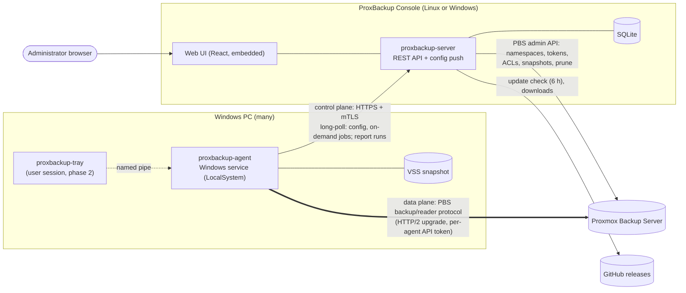
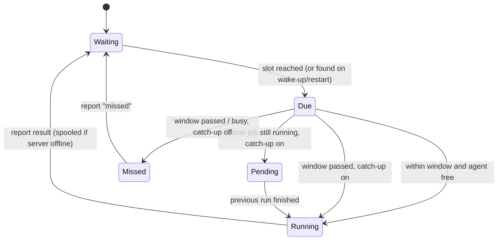
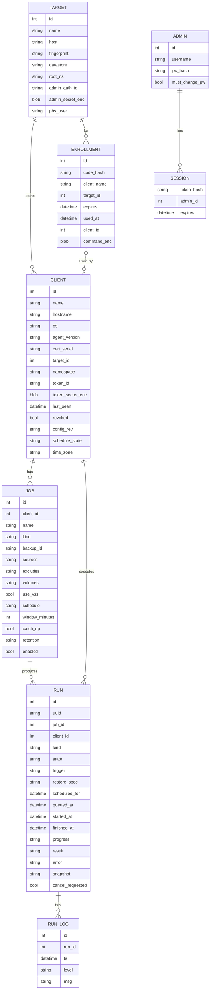
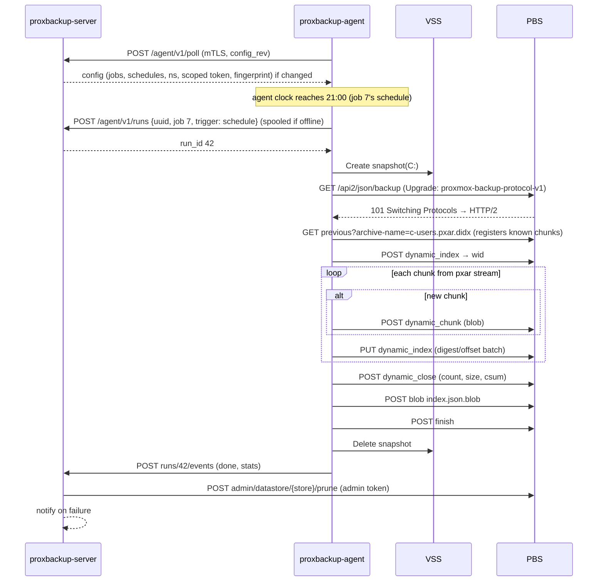

# ProxBackup Solution — Architecture

A centrally managed backup system for Windows PCs that stores backups **natively** on a
Proxmox Backup Server (PBS). There is no Linux proxy and no official `proxmox-backup-client`
in the data path: the Windows agent speaks the PBS backup protocol itself, so backups get the
same chunk-level deduplication, verification, sync and prune behaviour as any other PBS client.

## Goals

| Goal | How |
|------|-----|
| File-level backups of Windows PCs | VSS snapshot → pxar v1 archive → dynamic chunk index (`*.pxar.didx`) |
| Volume image backups | VSS snapshot of the volume device → fixed 4 MiB chunk index (`*.img.fidx`) |
| Central management | ProxBackup Console (on-premises management server) with web UI: clients, jobs, schedules, history, restore |
| No inbound ports on PCs | Agents dial out to the ProxBackup Console (long-poll over mTLS) |
| The PC decides when to back up | The server only pushes configuration. Each agent runs its own scheduler on the PC's clock, catches up missed runs if the job allows it, and keeps backing up while the server is down |
| Ransomware resilience | Agents get a PBS token with **DatastoreBackup** only — they can add backups, never delete or prune them |
| Interoperability | Snapshots are standard PBS snapshots: visible in the PBS GUI, verifiable, syncable, restorable with `proxmox-backup-client` on Linux |
| Hands-off updates | The console installs new GitHub releases in an admin-chosen maintenance window; Windows agents follow the console's version |

## System overview



**Control plane and data plane are separate.** Backup data never flows through the
ProxBackup Console: the agent uploads chunks straight to PBS. The console only
orchestrates the work.

## Components

### 1. `pkg/pbs`: PBS protocol library (Go)

This is a clean-room Go implementation of the PBS client protocol, written against the
upstream sources (`proxmox-backup` and `pxar` git repositories).

| Piece | Details |
|-------|---------|
| Auth | `Authorization: PBSAPIToken <user>@<realm>!<token>:<secret>`; TLS certificate pinned by SHA-256 fingerprint (PBS uses self-signed certs) |
| Session upgrade | `GET /api2/json/backup?store=&ns=&backup-type=host&backup-id=&backup-time=` with `Connection: upgrade`, `Upgrade: proxmox-backup-protocol-v1` → `101`, then HTTP/2 (prior knowledge) on the same TLS stream. Restore uses `/api2/json/reader` + `proxmox-backup-reader-protocol-v1` |
| Data blob | `MAGIC(8) ‖ CRC32(4, IEEE, over payload) ‖ payload`. Payload is a zstd frame when compression helps, otherwise raw. Encrypted variants add `IV(16) ‖ TAG(16)` (AES-256-GCM) |
| Chunk digest | `SHA-256(plain data)`; with encryption, `SHA-256(plain ‖ id_key)` where `id_key = PBKDF2-HMAC-SHA256(enc_key, "_id_key", 10)` |
| Chunker | Port of the upstream buzhash chunker (64-byte window, 4 MiB average, min/4, max×4). Identical boundaries mean chunks dedupe against Linux clients too |
| Dynamic index | `POST dynamic_index {archive-name}` → wid; `POST dynamic_chunk?wid&digest&size&encoded-size` (body = blob); `PUT dynamic_index` JSON `{wid, digest-list, offset-list}` (offsets are chunk **start** offsets); `POST dynamic_close?wid&chunk-count&size&csum` where `csum = SHA-256(Σ end_offset_le64 ‖ digest)` |
| Fixed index | Same with `fixed_*`, plus `size` on create; 4 MiB chunks; `csum = SHA-256(Σ digest)` |
| Incremental | `GET previous?archive-name=` downloads the last index and registers its chunks server-side; known chunks are appended without re-uploading |
| Manifest | `index.json.blob`: `{backup-type, backup-id, backup-time, files:[{filename, crypt-mode, size, csum}], unprotected:{}, signature}` → `POST blob?file-name=&encoded-size=`, then `POST finish` |

### 2. `pkg/pxar`: pxar v1 encoder and decoder

File-level backups must be real pxar archives. That way the PBS GUI, `proxmox-backup-client
restore`, and `pxar` FUSE mounts all work.

* Items are `Header{htype u64, full_size u64}` + payload, all little-endian.
* Per entry: `ENTRY{mode, flags, uid, gid, mtime{secs i64, nanos u32, pad u32}}`, then
  optional `XATTR`, then `PAYLOAD` for files or `SYMLINK` for links.
* Each directory: `FILENAME` (NUL-terminated, byte-sorted) + child archive, repeated, then a
  `GOODBYE` table. The table holds `{siphash24(name), rel_offset, size}` items in
  binary-search-tree array order, followed by a tail marker item.
* Windows mapping:

| Windows | pxar |
|---------|------|
| Directory / file | `S_IFDIR 0755` / `S_IFREG 0644` (`0444` if READONLY) |
| HIDDEN / SYSTEM / ARCHIVE | `flags`: `WITH_FLAG_HIDDEN 0x2000`, `WITH_FLAG_SYSTEM 0x4000`, `WITH_FLAG_ARCHIVE 0x8000` |
| LastWriteTime | `mtime` (100 ns resolution → ns) |
| Symlink reparse point | `SYMLINK` |
| Junctions / mount points | skipped (prevents loops and double-backup) |
| Security descriptor (NTFS ACL) | xattr `user.proxbackup.ntsd` (self-relative binary SD) *(phase 2)* |
| Alternate data streams | xattr `user.proxbackup.ads.<name>` for small streams *(phase 2)* |
| UTF-16 names | UTF-8 |

### 3. `proxbackup-agent`: ProxBackup Agent (Windows service)

* Runs as `LocalSystem` (needed for VSS and for reading every file), installed with
  `proxbackup-agent install`. Re-running the enrollment command on an enrolled PC keeps the
  existing service and restarts it.
* **Enrollment.** An admin creates a one-time enrollment code in the UI. The code bundles the
  server URL, a secret, and the server CA fingerprint. The agent generates an ECDSA key and
  CSR, and the server returns a client certificate signed by its internal CA. Every later
  call uses mTLS.
* **Configuration.** The agent long-polls `POST /agent/v1/poll` and sends the revision of the
  configuration it has. When the server's revision differs, it pushes the full config: the PBS
  target (endpoint, fingerprint, datastore, namespace, scoped API token) and all enabled jobs
  with their schedules. The agent stores it in `jobs.json` (0600). Saving a job in the UI wakes
  the poll, so changes arrive within seconds when the PC is online. At startup the agent tries a
  quick sync (≤10 s) before its first schedule check, so changes made while the PC was off take
  effect immediately.
* **Scheduling (agent-side).** See [Client-side scheduling](#client-side-scheduling) below.
  "Run now" and restores are the only work the server dispatches.
* **Reporting.** The agent registers runs it started itself with `POST /agent/v1/runs`, which is
  idempotent on a run UUID. Progress and logs then go to `POST /agent/v1/runs/{id}/events`. If
  the server is unreachable, the backup still runs. The report is spooled to disk (`spool/`) and
  delivered when the server is back, with the original start and finish times.
* **File backup.** For each volume touched by the sources, the agent creates one VSS
  snapshot, then walks `\\?\GLOBALROOT\Device\HarddiskVolumeShadowCopyN\…`. Each source path
  is streamed into the pxar encoder, then the chunker, then the uploader. Each source becomes
  one archive, e.g. `c-users.pxar.didx`.
* **Image backup.** The agent snapshots a volume with VSS and reads the shadow device
  sequentially into `drive-c.img.fidx` (4 MiB fixed chunks; zero chunks dedupe for free).
  Afterwards it lists the volume's files from the same shadow copy into the catalog, so the
  image can be browsed in the PBS GUI like a file backup (downloads need a pxar archive, so
  per-file restore from images is not possible there).
* **Catalog.** Every snapshot carries `catalog.pcat1.didx`, the file list the PBS GUI file
  browser reads. Its root holds one folder per archive. File backups fill it while encoding the
  pxar; a catalog failure only costs browsability, never the backup.
  Whole-disk restore of a dead machine goes through the Linux-based recovery image (see
  [Bare-metal recovery](#bare-metal-recovery), roadmap phase 4).
* **Restore.** The agent opens a reader session, downloads the index, fetches chunks on
  demand, decodes pxar, and writes files to the original or an alternate path. The overwrite
  policy (`skip`, `overwrite` or `if-newer`) is chosen per restore.
* **Self-update (Windows).** When the console runs a newer version, the poll reply offers it
  (version, SHA-256, size). Once no job is running, the agent downloads the binary from the
  console over mTLS, checks size, hash and the version the binary reports, swaps it in next to
  the running executable and exits; the service manager restarts it. A failed update is
  retried after an hour.
* **Local IPC** *(phase 2, with the tray app).* A named pipe `\\.\pipe\proxbackup-agent` will
  serve the tray app (status, "Back up now", recent runs), with a pipe ACL that allows only
  interactive users plus SYSTEM.

### 4. `proxbackup-server`: ProxBackup Console

* A single Go binary with the React SPA embedded (`go:embed`). SQLite via the pure-Go
  `modernc.org/sqlite`, so there is no cgo.
* **Listener.** One TLS port, `:8077`, serves the admin UI and API (session cookie + CSRF) and,
  under `/agent/`, the agent API (mTLS, client certs from the internal CA). The TLS handshake
  asks for a client certificate without requiring one, so browsers and enrollment (server auth
  only) work on the same port. `-agent-addr` can still split the agent API onto its own port.
* **Installed on the PBS host** (`.deb`, `packaging/deb`). The package creates the admin token
  `root@pam!proxbackup-console` with `proxmox-backup-manager`, and runs the console as the system
  user `proxbackup`, which can read the token secret. With `-local-pbs` the console registers
  every local datastore as a target on first start, re-reads the PBS certificate fingerprint over
  loopback hourly (so ACME renewals need no reconfiguration), and lets PBS administrators
  (`Sys.Modify` on `/`, e.g. `root@pam`) sign in with their PBS credentials. Accounts with
  two-factor auth must use a local console account for now.
* **Admin accounts.** Local accounts use argon2id hashes. The generated initial `admin`
  password must be changed at first sign-in; until then the API only answers `/api/me` and
  `/api/password`. Changing a password signs out the account's other sessions.
* **Enrollment codes.** Unused codes are listed under Clients as "Waiting for agent". The
  enrollment command is stored sealed with the master key so it can be shown again, and the
  client name is reserved until the code is used, cancelled or expires.
* **PBS integration.** The server is configured once per target with a PBS **admin** token. On
  enrollment it:
  1. creates namespace `<root-ns>/<client-name>` on the datastore,
  2. ensures the agent user (`proxbackup@pbs` by default, configurable per target) exists
     with `DatastoreBackup` on the root namespace (token privileges are intersected with the
     user's),
  3. creates API token `proxbackup@pbs!<client-name>`,
  4. grants `DatastoreBackup` on `/datastore/<store>/<ns>` to that token.

  The agent only ever receives the scoped token.
* **No scheduler.** The server does not start backups. It validates schedules, pushes them,
  and shows what the agents report: next run, pending catch-up, config sync state, and the PC's
  time zone.
* **Retention.** After each successful run, the server calls PBS `prune` for the backup group
  with the job's keep-last/hourly/daily/weekly/monthly/yearly policy, using the admin token.
  Garbage collection is left to PBS's own schedule.
* **Notifications.** SMTP and generic webhooks (JSON). Triggers: run failed or missed, run
  succeeded (optional), last successful backup older than N days (checked daily), console
  update installed or failed.
* **Automatic updates.** The console checks GitHub releases every 6 hours and installs the
  newest one in a weekday/time window set under Settings → Updates (default Sunday 03:00,
  60 min), or immediately with "Install now". Prereleases are opt-in. How it installs depends
  on how the console was installed:
  * *.deb:* the unprivileged service only writes `/var/lib/proxbackup/updates/request`. A
    `.path` unit starts the root helper `proxbackup-server-update.service`
    (`proxbackup-server apply-update`), which downloads the package from GitHub itself,
    verifies it against the release's `SHA256SUMS`, refuses downgrades and runs `dpkg`.
  * *Standalone binary:* the console downloads and verifies the new binary, swaps it in and
    re-executes itself.

  The console also caches the matching Windows agent binaries and offers them to older agents
  (see *Self-update* above; can be turned off). Releases are built by `make dist`, tagged with
  `make release` (`v<VERSION>`), and published by the GitHub Actions workflow
  `.github/workflows/release.yml`.

### 5. `proxbackup-tray`: user tray app *(phase 2)*

A small systray process started at login. It shows last backup time and status, offers
"Back up now" and "Restore files…" (opens the web UI deep link or a local picker), and can
pause backups while the user is on battery or a metered network.

## Client-side scheduling

The agent owns the schedule. Every 20 s, after waking from sleep, and right after a config
update or finished run, it checks each job's cron expression against the PC's local clock.
For each job it remembers the last slot it handled (`schedule.json`), so restarts never re-run
a slot.

| Situation at a scheduled slot | `catch_up = on` (default) | `catch_up = off` |
|---|---|---|
| Agent free, within the job's **start window** (default 60 min) | start, trigger `schedule` | start, trigger `schedule` |
| PC was off/asleep or the agent wasn't running, window passed | start immediately, trigger `catch-up` | record a `missed` run |
| Same job still running from the previous slot | start right after it finishes (`catch-up`) | record a `missed` run |
| Waited in the queue behind another job past the window | run as `catch-up` | record a `missed` run |

* Several missed slots, e.g. after three days off, are coalesced into **one** catch-up run.
* New jobs and changed schedules start counting from "now". They never catch up on slots from
  before the change.
* Schedules use the PC's local time zone, which is reported to the server and shown in the UI.
* `missed` runs appear in the history and trigger failure notifications, with warning severity.



## Data model (ProxBackup Console)



`kind` is `files`/`image` for jobs and also `restore` for runs. JSON columns (`sources`,
`retention`, `progress`, …) are stored as text. A `settings` key/value table holds
notification and update settings. Run history older than 180 days is pruned daily.

Secrets (`admin_secret_enc`, `token_secret_enc`, `command_enc`, and client encryption keys
in phase 2) are encrypted at rest with a server master key: `PROXBACKUP_MASTER_KEY` (32 bytes,
base64), or `master.key` in the data directory, generated with 0600 permissions on first start.

## Backup flow



## Security model

* **Agent ↔ server:** mTLS using the internal CA. Enrollment codes are single-use and expire
  (24 h by default, up to 30 days). Revoking a client in the UI marks it revoked, so its
  certificate is no longer accepted, and deletes its PBS token. Existing snapshots stay.
* **Agent ↔ PBS:** the PBS certificate fingerprint is pinned. The scoped token has
  `DatastoreBackup` only, so a compromised PC cannot read other PCs' backups or delete its
  own history.
* **Client-side encryption (phase 2):** a per-client AES-256-GCM key, generated by the server,
  stored encrypted at rest, and optionally escrowed with an RSA master public key (same idea
  as `proxmox-backup-client key create --master-pubkey`).
* **Immutable backups (phase 2):** PBS has no WORM mode, so immutability is layered:
  * *Lock window:* the console marks every new snapshot `protected` and unprotects it after a
    per-job lock period (e.g. 14 days). PBS refuses to prune or forget protected snapshots,
    which also guards against operator mistakes.
  * *Tamper-resistant retention:* today the console prunes after every reported run, so a
    compromised PC that floods the group with junk backups can push the good snapshots out
    (quickly with `keep-last`, over days with calendar buckets). Retention moves to a server
    schedule, backups per job and day are capped, and the oldest successful snapshot inside
    the lock window is always kept.
  * *Off-host copy:* the console's Admin token can still unprotect and delete, so a
    compromised console or PBS host defeats the two layers above. The real immutable copy is
    a second PBS that **pulls** from the primary with a read-only token and its own admins,
    with *remove vanished* off; the primary holds no credentials for it. The console guides
    this setup and checks it (sync freshness surfaces with phase 5 sync-job awareness). Tape
    via PBS tape backup is the offline alternative.
* **Admin UI:** session cookie plus a custom request header (`X-PROXBACKUP-Request`) against
  CSRF. Local admin accounts (argon2id, forced change of the generated initial password), PBS
  administrators via their PBS credentials on the PBS host, optional OIDC in phase 5 (SSO with
  MFA for the MSP console in phase 6).
* **Updates:** the console and its root helper only install release assets whose SHA-256
  matches the release's `SHA256SUMS`, and never downgrade. Agents verify the binary's size,
  hash and reported version and only fetch it from the console over mTLS. Releases are not
  signed yet, so the GitHub repository is part of the trust base.

## Repository layout

```
cmd/proxbackup-server/  ProxBackup Console entrypoint (also `apply-update` for the root helper)
cmd/proxbackup-agent/   ProxBackup Agent entrypoint (service + CLI: enroll, backup, image, restore)
pkg/pbs/                PBS protocol: blob, chunker, catalog, backup & reader sessions, admin API
pkg/pxar/               pxar v1 encoder/decoder
internal/agent/         scheduler, job runner, VSS, file walker, image reader, catalog,
                        run reporter/spool, self-update
internal/server/        HTTP API, auth, store (SQLite), PKI, config push, PBS provisioning,
                        local-PBS integration, notify, updater
internal/schedule/      cron parsing and "is a slot due?" logic shared by agent and server
internal/update/        GitHub release lookup, asset download/verification, update window
internal/api/           shared JSON types between agent and server
web/                    React + Vite admin UI (built into internal/server/webdist)
packaging/deb/          Debian package files and systemd units for the console
tools/mkdeb/            builds the console .deb
scripts/                version bump, release, PBS E2E test, Windows VM test
.github/workflows/      release workflow (builds and publishes tagged releases)
docs/                   this document
```

## Roadmap

| Phase | Scope |
|-------|-------|
| **1 — MVP** (implemented; verified against PBS 4.2, with a Windows 11 ARM64 VM for the Windows paths) | PBS protocol library, pxar encoder, buzhash chunker, file backup with VSS, volume image backup, PBS GUI catalog for file and image backups, enrollment + mTLS, agent-side scheduling with catch-up, run history and logs, retention via prune, webhook/SMTP notifications, restore of pxar archives to a folder, React UI, console `.deb` for the PBS host (port 8077, PBS sign-in), automatic console and Windows agent updates from GitHub releases |
| 2 | File restore from images (NTFS reader over the fixed index), client-side encryption + key escrow, NTFS ACLs and ADS in xattrs, tray app, per-file restore browser in the UI, bandwidth limits, metered-network/battery awareness, immutable backups (lock window via the PBS `protected` flag, tamper-resistant retention, guided pull-sync to a second PBS; see [Security model](#security-model)) |
| 3 — macOS & Linux agents | First-class `proxbackup-agent` for macOS and Linux (see [Platform support](#platform-support)): full Unix metadata (mode, uid/gid with names, xattrs, POSIX ACLs, file flags, hard links), consistent snapshots (APFS local snapshots on macOS; LVM, btrfs and ZFS snapshots on Linux, with live reads as an explicit fallback), per-OS default sources and excludes, Full Disk Access onboarding on macOS, launchd/systemd install verified, per-OS enrollment commands and packages (`.pkg`, `.deb`/`.rpm`) in the UI, agent self-update on macOS and Linux, CI runs the E2E suite on Linux and macOS |
| 4 — Bare-metal recovery | Linux-based **ProxBackup Rescue** boot image (USB/ISO + network boot) that restores whole Windows and Linux machines from PBS. Disk-layout capture in image jobs, partition recreation, volume restore, boot repair. See [Bare-metal recovery](#bare-metal-recovery) |
| 5 | Changed-block tracking for images, OIDC login, multi-PBS targets, sync-job awareness |
| 6 — MSP cloud console | Cloud-hosted, multi-tenant **ProxBackup Cloud** console for managed service providers: one pane of glass over all customers' sites, cross-customer alerting, policy templates, technician RBAC scoped per customer, reporting and usage metering for billing, PSA/RMM integrations, optional hosted management servers. See [MSP cloud console](#msp-cloud-console) |

## Platform support

| | Windows | macOS | Linux |
|---|---|---|---|
| Builds and runs | ✅ tested (Windows 11 ARM64 VM, `scripts/windows-vm-test.ps1`) | ✅ tested | ✅ builds; not yet run |
| Scheduling, catch-up, offline operation, restore | ✅ | ✅ | ✅ |
| Consistent snapshot | VSS | ❌ live reads *(phase 3: APFS snapshots)* | ❌ live reads *(phase 3: LVM / btrfs / ZFS)* |
| File metadata | attributes, timestamps (ACLs/ADS in phase 2) | ❌ mtime + read-only only *(phase 3)* | ❌ mtime + read-only only *(phase 3)* |
| Service install | Windows service | launchd *(not yet verified)* | systemd *(not yet verified)* |
| Agent self-update | ✅ | ❌ *(phase 3)* | ❌ *(phase 3)* |
| Bare-metal restore | *phase 4: ProxBackup Rescue* | ❌ not planned (see below) | *phase 4: ProxBackup Rescue* |

Today the non-Windows agent is a development build. It backs up and restores file contents,
names, symlinks and timestamps correctly, but records every file as owned by root with default
permissions. Don't use it to protect Mac or Linux machines until phase 3.

## Bare-metal recovery

*Roadmap phase 4.* **ProxBackup Rescue** is one small Linux live image that restores a whole
Windows or Linux machine onto an empty or replacement disk, with no working OS needed. It
replaces the earlier WinPE idea: a single image covers both OSes, ships without Microsoft
licensing questions, and reuses the same Go agent code.

**What gets captured at backup time** (image jobs gain a "whole disk" mode):

- `disk-layout.json.blob`: partition table (GPT/MBR), partition GUIDs/types/sizes/flags, disk
  and filesystem UUIDs, boot entries, and the OS and hardware summary (disk model, NIC
  drivers, BitLocker/LUKS status).
- One fixed-chunk image per partition. Windows: EFI system partition, MSR and recovery partition
  read raw (small, rarely change), the OS volume via its VSS snapshot. Linux: per-filesystem
  images from LVM/btrfs/ZFS snapshots (phase 3), or file-level pxar plus layout for btrfs/ZFS.

**The rescue image:**

- Debian-based live system booting via the signed shim, so **Secure Boot can stay on**. Ships
  as an ISO/USB image (UEFI + legacy BIOS) and as an iPXE/HTTP-boot entry for network recovery.
  Kernel with broad storage/NIC drivers plus ntfs-3g, e2fsprogs, xfsprogs, btrfs-progs, LVM,
  mdadm, cryptsetup and efibootmgr.
- `proxbackup-agent` in recovery mode with a text UI on the console and a small local web UI, so a
  technician can drive it from a phone or laptop.
- **Authentication:** an admin generates a one-time *recovery code* in the server UI (short
  lifetime, bound to one client). It grants read-only restore access to that client's
  snapshots: a temporary PBS token with `DatastoreReader` on the client's namespace, revoked
  after use. Direct PBS credentials are possible as an offline fallback.

**Restore flow:**

1. Boot, get network (DHCP or manual), enter the server URL and recovery code (or scan a QR
   code shown in the UI).
2. Choose client → snapshot → target disk. The image shows a size check and a
   "this disk will be erased" confirmation.
3. Recreate the partition layout, scaled proportionally if the new disk is larger. Smaller
   disks work if the used data fits: filesystems are shrunk where supported.
4. Stream the partition images from PBS straight to the partitions. Chunks are fetched in
   parallel, and zero chunks become sparse writes.
5. Fix up and boot:
   - **Windows:** ESP and BCD come back with the image. If the disk or partition GUIDs changed,
     update the BCD device entries and recreate the UEFI boot entry with `efibootmgr`.
     Dissimilar hardware (different storage controller) is best-effort: inject storage drivers
     offline, otherwise restore to similar hardware.
   - **Linux:** keep filesystem UUIDs, so `fstab`, `crypttab` and GRUB keep working. Reinstall
     GRUB/systemd-boot from a chroot when the bootloader isn't on an imaged partition.
6. Reboot and report the result to the server, which shows a "bare-metal restore" run in
   the client history.

**Encrypted disks:** VSS snapshots of BitLocker volumes are read decrypted, so restored
volumes are unencrypted. The rescue UI says so, and BitLocker must be re-enabled afterwards.
LUKS on Linux is restored as LUKS: the image is of the opened mapper device, and the LUKS
container is recreated with the user's passphrase.

The rescue image also does **file-level restore**: browse snapshots and copy files to a USB disk,
or into the existing installation of a machine that won't boot.

**Why not macOS:** Apple-silicon Macs only boot operating systems signed by Apple, or with
reduced security after a manual Recovery-mode change, so a generic rescue image can't be
booted. The system volume is a sealed, signed APFS snapshot that can't be recreated from a
backup. Apple's supported path is: reinstall macOS from macOS Recovery, then restore user
data. For Macs, ProxBackup will offer **data restore onto a freshly installed macOS** (user folders,
apps and settings from the file-level archives) instead of bare-metal recovery.

## MSP cloud console

*Roadmap phase 6.* **ProxBackup Cloud** is a hosted, multi-tenant console for managed service
providers (MSPs) who run proxbackup for many customers. Today each customer has its own
ProxBackup Console with its own UI, so an MSP has to log in to every one of them. The console
gives technicians one place to see and manage all customers, without changing where backups
are stored or who holds the keys.


**Hierarchy:** MSP → customer → site (one ProxBackup Console) → clients → jobs. Every object in
the console belongs to exactly one customer, and every query is scoped by tenant.

**How sites connect:**

- **Connected on-prem consoles.** An existing ProxBackup Console is linked with a one-time
  *site code* from the console. It then dials out to the console (mTLS, long-poll, the same
  pattern agents use), so customer firewalls need no inbound rules. The site sends client
  state, run results and alerts up, and receives policy changes and actions.
- **Hosted consoles.** For customers without a server of their own, the console runs a
  ProxBackup Console instance per customer. Agents enroll against it over the internet; backup data
  still goes straight to PBS (the customer's, or an MSP-operated datastore with one namespace
  tree per customer).
- **Sites stay autonomous.** If the console is unreachable, sites and agents keep backing up
  and keep their local UI. State is reconciled when the link comes back.

**Features:**

- **Fleet dashboard:** all customers, sites and clients with health at a glance (last good
  backup, failed/missed runs, offline agents, PBS datastore usage, outdated agents), with
  drill-down into any client's history, logs and snapshots.
- **Cross-customer alerting:** one alert queue with acknowledge/assign/snooze, and routing per
  customer (email, webhook, Teams/Slack).
- **Policy templates:** job definitions (sources, excludes, schedule, window, catch-up,
  retention) defined once and assigned per customer, site or client group. Sites apply them as
  normal jobs and report drift.
- **Mass operations:** agent rollout packages per customer (pre-filled enrollment), staged
  agent upgrades, "run now" or pause across a selection.
- **Restore from the console:** browse snapshots and start file restores; bare-metal
  recovery codes (phase 4) can be issued here.
- **Reporting:** per-customer backup success/SLA reports (scheduled PDF/email), and usage
  metering (protected devices, logical and deduplicated TB per customer) exported for billing.
- **Integrations:** PSA/RMM ticketing and device sync (ConnectWise, Autotask, HaloPSA,
  NinjaOne), plus a public REST API and webhooks.
- **Customer portal (optional, white-label):** customers see their own status and reports and
  can restore their own files, within limits set by the MSP.

**Security model:**

- **Technician access:** SSO (OIDC/SAML) with MFA required, roles (owner, admin, technician,
  read-only) scoped to all customers or a subset, and an immutable audit log of every action,
  per customer and exportable.
- **The console never holds PBS admin tokens or encryption keys.** These stay on each
  ProxBackup Console. The console sends signed *requests*, and the site server authorizes and
  carries them out with its own credentials. For hosted servers, secrets live in per-tenant
  instances, encrypted with per-tenant keys.
- **A compromised console must not be able to destroy backups.** Sites refuse destructive or
  weakening actions from the console by default: deleting snapshots, removing clients, and
  shortening retention or disabling jobs need local approval on the site, or a delay (e.g.
  72 h with notification to the customer's contacts) before they take effect. Agents keep
  their `DatastoreBackup`-only tokens, so ransomware on a PC still can't delete history.
- **Tenant isolation:** row-level tenant scoping enforced in the data layer, separate
  per-customer PBS namespaces/datastores, and per-site connector certificates that can be
  revoked from either side.

## Risks and mitigations

| Risk | Mitigation |
|------|-----------|
| PBS protocol changes | The protocol is versioned (`-v1`) and stable since PBS 1.0. `make e2e` runs the protocol tests against a PBS 4.2 container (not yet part of CI; the release workflow runs `make test`) |
| pxar encoding bugs make backups unrestorable | Round-trip tests with our decoder; snapshots are browsable and downloadable in the PBS GUI. Validation with the official `pxar` crate / `proxmox-backup-client` in the E2E suite is still to do |
| VSS failures (writers in bad state, no space) | The backup fails with the VSS error rather than silently reading live files. Jobs can turn VSS off (`use_vss`) to back up crash-inconsistent live data instead |
| Long paths / odd names | `\\?\` prefixed paths throughout; files that can't be read or encoded are skipped with a warning in the run log |
| A bad release breaks every console and agent | Updates install only in the admin's window, refuse downgrades, and verify `SHA256SUMS`; agents update only when idle and back off for an hour after a failure. Prereleases are opt-in |
| Locked files without VSS | VSS is the default; without it, files are skipped and warned about, never silently dropped |
| Compromised console or PBS host deletes all backups (it holds an Admin token) | Phase 2: lock window via `protected`, plus a pull-synced second PBS or tape that the primary can't reach |
| Compromised PC floods its group so retention prunes the good snapshots | Phase 2: scheduled retention, per-day run cap, oldest good snapshot in the lock window always kept |
